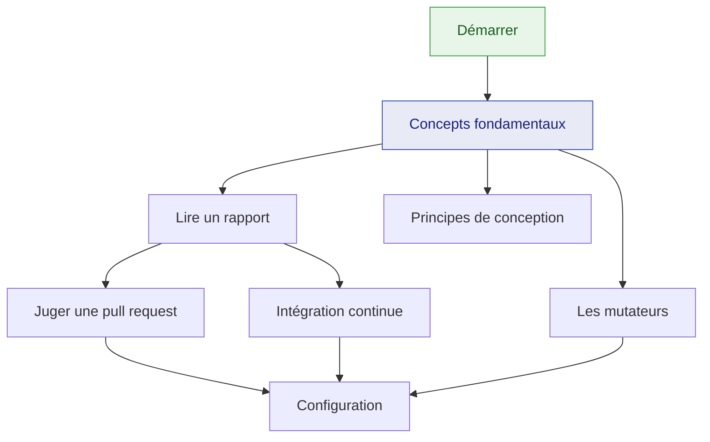

# Documentation de KillMutants

🌍 **Langues :**  
🇬🇧 [English](./README.md) | 🇫🇷 Français (ce fichier)

KillMutants modifie votre code par petites touches délibérées — `>=` devient `>`, `&&` devient
`||` — et lance vos tests contre chaque modification. Une modification que les tests attrapent est
un mutant **tué** ; une qu'ils laissent passer **survit**, et désigne le code que vos tests
exécutent sans le vérifier.

## Commencer ici

**Nouveau dans le mutation testing, ou dans l'outil ?** →
[**Démarrer**](./guides/getting-started-fr.md) — dix minutes de l'installation à votre premier
survivant tué.

## Guides

Le parcours conceptuel. Lisez-les dans l'ordre la première fois.

| Guide | Ce que vous y trouvez |
| --- | --- |
| [Démarrer](./guides/getting-started-fr.md) | l'installation, une première exécution, un rapport lu ligne à ligne, un survivant tué |
| [Concepts fondamentaux](./guides/core-concepts-fr.md) | ce qu'est un mutant, les cinq verdicts, comment se déroule une exécution, comment le score est calculé |
| [Les mutateurs](./guides/mutators-fr.md) | les seize familles, ce que chacune demande à vos tests, et comment choisir un catalogue |
| [Lire un rapport](./guides/reading-a-report-fr.md) | le rapport console section par section, le rapport JSON, les codes de sortie |
| [Juger une pull request](./guides/pull-requests-fr.md) | `--since` : un verdict sur une modification en quelques secondes, et pourquoi il n'affiche aucun score |
| [Intégration continue](./guides/continuous-integration-fr.md) | barrières de qualité (gates), échéances, séries réparties sur plusieurs jobs, un job GitHub Actions prêt à l'emploi |
| [Principes de conception](./guides/design-principles-fr.md) | ce que l'outil refuse à dessein, et pourquoi |
| [FAQ](./guides/faq-fr.md) | des réponses courtes aux questions qui reviennent le plus souvent |

## Référence

De quoi consulter ponctuellement.

| Page | Contenu |
| --- | --- |
| [Configuration](./guides/configuration-fr.md) | chaque option de la ligne de commande, chaque clé de `killmutants.json`, et comment les deux se combinent |
| [Lire un rapport](./guides/reading-a-report-fr.md#le-rapport-json) | chaque champ du rapport JSON, le journal des verdicts et le plan |
| [Les mutateurs](./guides/mutators-fr.md#le-catalogue) | la table des familles, et ce qui est délibérément laissé intact |

## Comment tout s'articule

## Parcours d'apprentissage

**L'essayer sur un projet pour la première fois**

1. [Démarrer](./guides/getting-started-fr.md) — une exécution, un rapport, un survivant tué
2. [Concepts fondamentaux](./guides/core-concepts-fr.md) — comprendre ce que les nombres veulent
   dire avant de les citer
3. [Les mutateurs](./guides/mutators-fr.md) — décider quelles familles méritent leur place sur
   *votre* code
4. [Lire un rapport](./guides/reading-a-report-fr.md) — connaître chaque ligne avant que le rapport
   ne s'allonge

**Le mettre dans le pipeline**

1. [Juger une pull request](./guides/pull-requests-fr.md) — la barrière de qualité que la plupart
   des équipes veulent en premier
2. [Intégration continue](./guides/continuous-integration-fr.md) — échéances, séries, le balayage
   nocturne
3. [Configuration](./guides/configuration-fr.md) — déplacer les options dans `killmutants.json`
4. [Principes de conception](./guides/design-principles-fr.md) — savoir ce qu'il refusera avant
   qu'il ne le fasse

## Pour les mainteneurs

Les documents ci-dessous décrivent **pourquoi** l'outil est construit ainsi. Ils ne décrivent pas
ce qu'il fait aujourd'hui ; ce sont les guides ci-dessus qui s'en chargent.

| Document | Ce que c'est |
| --- | --- |
| [Architecture](./architecture-fr.md) | les contraintes, le pipeline, le modèle de domaine, les risques et les mesures qui les étayent |
| [Étude de Stryker.NET](./study/stryker-net-fr.md) | ce que l'implémentation de référence a appris, et ce qui a été délibérément fait autrement |
| [Backlog de robustesse](./robustness-backlog-fr.md) | les cas limites hérités de Stryker.NET, sous forme de spécifications et de tests |
| [Enregistrements de décisions](./decisions/README-fr.md) | les choix coûteux à inverser, un `DECnnnn` chacun |

* [Politique de sécurité](../SECURITY.md) — comment signaler une vulnérabilité
* [Publication](../RELEASING.md) — les trains de publication et le chemin jusqu'à la mise en ligne
* [Conventions](../CLAUDE.md) — les règles que rien dans le dépôt ne fait respecter

---

[← README du dépôt](../README.md)
