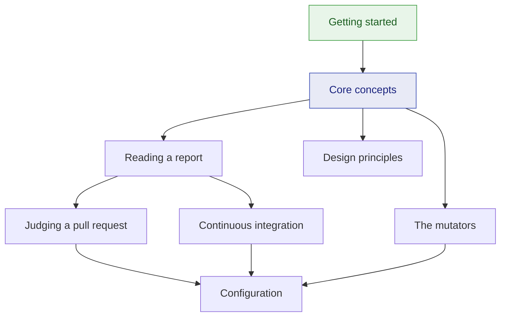

# KillMutants documentation

🌍 **Languages:**  
🇬🇧 English (this file) | 🇫🇷 [Français](./README-fr.md)

KillMutants changes your code in small, deliberate ways — `>=` into `>`, `&&` into `||` — and runs
your tests against each change. A change the tests catch is a **killed** mutant; one they let
through **survives**, and names the code your tests execute without checking.

## Start here

**New to mutation testing, or to the tool?** → [**Getting started**](./guides/getting-started-en.md)
— ten minutes from installing it to killing your first survivor.

## Guides

The conceptual path. Read them in order the first time.

| Guide | What you get |
| --- | --- |
| [Getting started](./guides/getting-started-en.md) | install, a first run, a report read line by line, a survivor killed |
| [Core concepts](./guides/core-concepts-en.md) | what a mutant is, the five verdicts, how a run works, how the score is computed |
| [The mutators](./guides/mutators-en.md) | the sixteen families, what each one asks of your tests, and how to choose a catalogue |
| [Reading a report](./guides/reading-a-report-en.md) | the console report section by section, the JSON report, the exit codes |
| [Judging a pull request](./guides/pull-requests-en.md) | `--since`: a verdict on a change in seconds, and why it prints no score |
| [Continuous integration](./guides/continuous-integration-en.md) | gates, deadlines, series over several jobs, a ready-made GitHub Actions job |
| [Design principles](./guides/design-principles-en.md) | what the tool refuses on purpose, and why |
| [FAQ](./guides/faq-en.md) | short answers to the questions that come up most |

## Reference

Look-up material.

| Page | Covers |
| --- | --- |
| [Configuration](./guides/configuration-en.md) | every command-line option, every `killmutants.json` key, and how the two combine |
| [Reading a report](./guides/reading-a-report-en.md#the-json-report) | every field of the JSON report, the verdict log and the plan |
| [The mutators](./guides/mutators-en.md#the-catalogue) | the table of families, and what is deliberately left alone |

## How it all fits together

## Learning paths

**Trying it on a project for the first time**

1. [Getting started](./guides/getting-started-en.md) — one run, one report, one survivor killed
2. [Core concepts](./guides/core-concepts-en.md) — understand what the numbers mean before you quote them
3. [The mutators](./guides/mutators-en.md) — decide which families earn their keep on *your* code
4. [Reading a report](./guides/reading-a-report-en.md) — know every line before the report gets long

**Putting it in the pipeline**

1. [Judging a pull request](./guides/pull-requests-en.md) — the gate most teams want first
2. [Continuous integration](./guides/continuous-integration-en.md) — deadlines, series, the nightly sweep
3. [Configuration](./guides/configuration-en.md) — move the flags into `killmutants.json`
4. [Design principles](./guides/design-principles-en.md) — know what it will refuse before it does

## For maintainers

The documents below describe **why** the tool is built as it is. They are not a description of
what it does today; the guides above are.

| Document | What it is |
| --- | --- |
| [Architecture](./architecture-en.md) | the constraints, the pipeline, the domain model, the risks and the measurements behind them |
| [Study of Stryker.NET](./study/stryker-net-en.md) | what was learned from the reference implementation, and what was deliberately done differently |
| [Robustness backlog](./robustness-backlog-en.md) | the edge cases inherited from Stryker.NET, as specifications and tests |
| [Decision records](./decisions/README.md) | the choices that are expensive to reverse, one `DECnnnn` each |

* [Security policy](../SECURITY.md) — how to report a vulnerability
* [Releasing](../RELEASING.md) — the release trains and the publish path
* [Conventions](../CLAUDE.md) — the rules nothing in the repository enforces

---

[← Repository README](../README.md)
