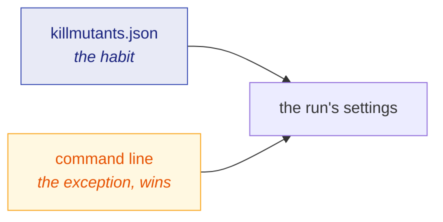

# Configuration

🌍 **Languages:**  
🇬🇧 English (this file) | 🇫🇷 [Français](./configuration-fr.md)

Every setting can be given on the command line, and every setting that states a *habit* can be kept
in `killmutants.json` beside the code. This page lists both, and says how they combine.

## The rule



* **The file states the habit, the command line states the exception.** Anything given on the
  command line wins.
* **A list on the command line replaces the file's**, it does not add to it. `--without none`,
  `--break-at none`, `--stop-after none` and `--ignore-calls none` clear what the file sets.
* **An option given twice on the command line:** for a single-value option, the last one wins. A
  list option accumulates, and `none` clears what it has accumulated so far:
  `--without Linq --without Comparison` leaves both out, `--without Linq --without none` leaves
  nothing out.
* **Paths in the file are relative to the file.**
* **A misspelt key stops the run** rather than being ignored. Running with settings nobody asked
  for is the same failure as a misspelt family name, and it is refused the same way.
* **`--since` and `--resume` have no key.** They say what *one* run is about, not what the project
  habitually does.

The file is read from the directory the run was pointed at. Comments and trailing commas are fine:
it is written by hand, so it is read the way a person writes.

## `killmutants.json`

```jsonc
{
  // Build and scope
  "configuration": "Release",
  "targetFramework": "net10.0",
  "exclude": ["tests/fixtures/*", "*.Generated.cs"],

  // Catalogue
  "mutators": [],                          // only these families; empty means all
  "with": ["NumericLiteral"],              // add to the default families
  "without": ["StringLiteral"],            // leave out
  "ignoreCalls": ["System.ArgumentNullException.ThrowIfNull", "*.ConfigureAwait"],

  // Execution
  "parallel": 4,
  "coverage": true,
  "stopAfter": "80m",
  "slow": "30s",
  "verifyKills": 10,
  "ignoreUntracked": ["*.received.html"],  // only a --resume run reads it

  // Output and gate
  "breakAt": 80,
  "reportJson": "artifacts/mutation.json",
  "progress": "log"
}
```

| Key | Option | Default | What it does |
| --- | --- | --- | --- |
| `configuration` | `-c`, `--configuration <cfg>` | `Release` | the build configuration to analyse and run |
| `targetFramework` | `--target-framework <tfm>` | — | the one framework the test projects run on; needed when a test project targets several |
| `exclude` | `-e`, `--exclude <pattern>` | — | leave a project or file alone; repeatable, matched against the path relative to the directory, `*` matches `/` too |
| `mutators` | `-m`, `--mutators <list>` | every default family | run only these families |
| `with` | `--with <list>` | — | add these families to the others; how `NumericLiteral` is turned on |
| `without` | `--without <list>` | — | leave these families out, applied after the two above |
| `ignoreCalls` | `--ignore-calls <pattern>` | — | silence the mutants of a call's statement and arguments, by the bound method's fully qualified name; repeatable |
| `parallel` | `-p`, `--parallel <n>` | half the processors | how many mutants to test at once |
| `coverage` | `--no-coverage` to turn off | `true` | run only the tests that reach each mutant |
| `stopAfter` | `--stop-after <time>` | — | a deadline for the run, written `85m`, `90s`, `1h30m`; the run then reports what it judged |
| `slow` | `--slow <time>` | `30s` | name a mutant still running after this long, once |
| `verifyKills` | `--verify-kills <n>` | `0` | test this many kills a second time, alone |
| `ignoreUntracked` | `--ignore-untracked <pattern>` | — | with `--resume`: untracked files that do not make the tree dirty; repeatable |
| `breakAt` | `--break-at <percent>` | — | exit `1` when the score falls below this; refused with `--since` |
| `reportJson` | `--report-json <path>` | — | also write the report as JSON; the verdict log and the plan land beside it |
| `progress` | `--progress <mode>` | `log` | what standard error shows: `log`, `live` or `none` |

## Command line only

| Option | What it does |
| --- | --- |
| `[directory]` | where to look for projects; the current directory by default |
| `--since <revision>` | judge only what changed since a git revision — a branch, a tag, a commit — and answer with a verdict rather than a score ([Judging a pull request](./pull-requests-en.md)) |
| `--resume <id>` | belong to the series named `<id>`, inheriting the verdicts an earlier run of it reached; needs `--report-json` ([Continuous integration](./continuous-integration-en.md#finishing-a-large-project-over-several-runs)) |
| `-h`, `--help` | the same table, from the tool itself |

## In the projects themselves

Two things are declared in a `.csproj` or in the code rather than in `killmutants.json`, because
they describe the project rather than the run:

| Declaration | Says |
| --- | --- |
| `<KillMutantsTestSupport>true</KillMutantsTestSupport>` | this project is test scaffolding — builders, fakes, helpers — and is left out of the run without hiding what it references |
| `[ExcludeFromCodeCoverage]` | this code is not part of what the tests are expected to cover, so nothing under it is mutated |

## Durations and lists

A duration is written as a number and a unit, combined freely: `90s`, `85m`, `1h30m`.

A list on the command line is comma separated — `--without StringLiteral,BooleanLiteral` — and a
repeatable option may also be given several times. Family names are the ones the report prints
under `By mutator`; a misspelt one is refused.

## Where to go next

| If you want to… | Read |
| --- | --- |
| decide which families to keep | [The mutators](./mutators-en.md#choosing-a-catalogue) |
| wire the options into a pipeline | [Continuous integration](./continuous-integration-en.md) |
| know what each exit code means to a script | [Reading a report](./reading-a-report-en.md#exit-codes) |

---

[← Documentation index](../README.md)
