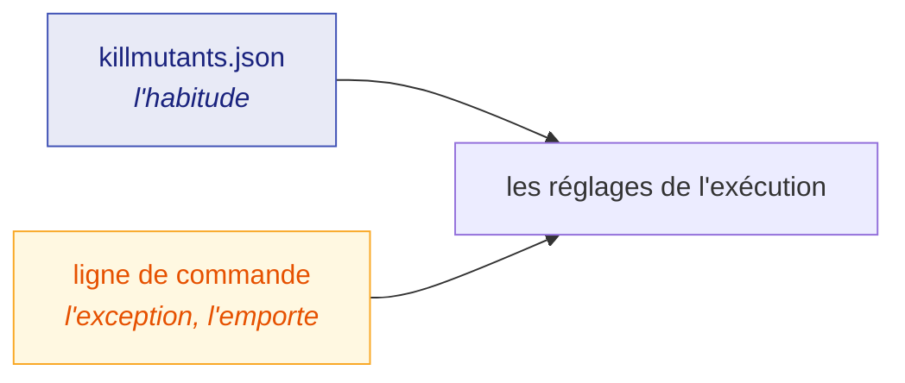

# Configuration

🌍 **Langues :**  
🇬🇧 [English](./configuration-en.md) | 🇫🇷 Français (ce fichier)

Chaque réglage peut être donné sur la ligne de commande, et chaque réglage qui exprime une
*habitude* peut être conservé dans `killmutants.json` à côté du code. Cette page liste les deux, et
dit comment ils se combinent.

## La règle



* **Le fichier exprime l'habitude, la ligne de commande exprime l'exception.** Tout ce qui est
  donné sur la ligne de commande l'emporte.
* **Une liste sur la ligne de commande remplace celle du fichier**, elle ne s'y ajoute pas.
  `--without none`, `--break-at none`, `--stop-after none` et `--ignore-calls none` effacent ce que
  le fichier définit.
* **Une option donnée deux fois sur la ligne de commande :** pour une option à valeur unique, la
  dernière l'emporte. Une option de liste s'accumule, et `none` vide ce qu'elle a accumulé
  jusque-là : `--without Linq --without Comparison` écarte les deux,
  `--without Linq --without none` n'écarte rien.
* **Les chemins du fichier sont relatifs au fichier.**
* **Une clé mal orthographiée arrête l'exécution** plutôt que d'être ignorée. S'exécuter avec des
  réglages que personne n'a demandés est le même échec qu'un nom de famille mal orthographié, et
  c'est refusé de la même façon.
* **`--since` et `--resume` n'ont pas de clé.** Ils disent de quoi *une* exécution traite, pas ce
  que le projet fait habituellement.

Le fichier est lu depuis le répertoire vers lequel l'exécution a été pointée. Les commentaires et
les virgules finales sont acceptés : il est écrit à la main, il est donc lu comme une personne
l'écrit.

## `killmutants.json`

```jsonc
{
  // Construction et périmètre
  "configuration": "Release",
  "targetFramework": "net10.0",
  "exclude": ["tests/fixtures/*", "*.Generated.cs"],

  // Catalogue
  "mutators": [],                          // seulement ces familles ; vide signifie toutes
  "with": ["NumericLiteral"],              // à ajouter aux familles par défaut
  "without": ["StringLiteral"],            // à laisser de côté
  "ignoreCalls": ["System.ArgumentNullException.ThrowIfNull", "*.ConfigureAwait"],

  // Exécution
  "parallel": 4,
  "coverage": true,
  "stopAfter": "80m",
  "slow": "30s",
  "verifyKills": 10,
  "ignoreUntracked": ["*.received.html"],  // seule une exécution --resume le lit

  // Sortie et barrière de qualité
  "breakAt": 80,
  "reportJson": "artifacts/mutation.json",
  "progress": "log"
}
```

| Clé | Option | Défaut | Ce qu'elle fait |
| --- | --- | --- | --- |
| `configuration` | `-c`, `--configuration <cfg>` | `Release` | la configuration de build à analyser et à exécuter |
| `targetFramework` | `--target-framework <tfm>` | — | le framework unique sur lequel les projets de test s'exécutent ; nécessaire quand un projet de test en cible plusieurs |
| `exclude` | `-e`, `--exclude <pattern>` | — | laisser un projet ou un fichier tranquille ; répétable, confronté au chemin relatif au répertoire, `*` correspond aussi à `/` |
| `mutators` | `-m`, `--mutators <list>` | chaque famille par défaut | n'exécuter que ces familles |
| `with` | `--with <list>` | — | ajouter ces familles aux autres ; c'est ainsi que `NumericLiteral` s'active |
| `without` | `--without <list>` | — | laisser ces familles de côté, appliqué après les deux précédentes |
| `ignoreCalls` | `--ignore-calls <pattern>` | — | faire taire les mutants de l'instruction et des arguments d'un appel, par le nom pleinement qualifié de la méthode liée ; répétable |
| `parallel` | `-p`, `--parallel <n>` | la moitié des processeurs | combien de mutants tester à la fois |
| `coverage` | `--no-coverage` pour désactiver | `true` | n'exécuter que les tests qui atteignent chaque mutant |
| `stopAfter` | `--stop-after <time>` | — | une échéance pour l'exécution, écrite `85m`, `90s`, `1h30m` ; l'exécution rapporte alors ce qu'elle a jugé |
| `slow` | `--slow <time>` | `30s` | nommer, une seule fois, un mutant qui s'exécute encore au-delà de cette durée |
| `verifyKills` | `--verify-kills <n>` | `0` | tester une seconde fois, isolément, ce nombre de mises à mort |
| `ignoreUntracked` | `--ignore-untracked <pattern>` | — | avec `--resume` : les fichiers non suivis qui ne rendent pas l'arbre sale ; répétable |
| `breakAt` | `--break-at <percent>` | — | sortir avec le code `1` quand le score tombe sous cette valeur ; refusé avec `--since` |
| `reportJson` | `--report-json <path>` | — | écrire aussi le rapport en JSON ; le journal des verdicts et le plan atterrissent à côté |
| `progress` | `--progress <mode>` | `log` | ce que la sortie d'erreur standard affiche : `log`, `live` ou `none` |

## Ligne de commande seulement

| Option | Ce qu'elle fait |
| --- | --- |
| `[directory]` | où chercher les projets ; le répertoire courant par défaut |
| `--since <revision>` | ne juger que ce qui a changé depuis une révision git — une branche, un tag, un commit — et répondre par un verdict plutôt que par un score ([Juger une pull request](./pull-requests-fr.md)) |
| `--resume <id>` | appartenir à la série nommée `<id>`, en héritant des verdicts qu'une exécution antérieure de celle-ci a atteints ; nécessite `--report-json` ([Intégration continue](./continuous-integration-fr.md#terminer-un-grand-projet-en-plusieurs-exécutions)) |
| `-h`, `--help` | le même tableau, depuis l'outil lui-même |

## Dans les projets eux-mêmes

Deux choses se déclarent dans un `.csproj` ou dans le code plutôt que dans `killmutants.json`, parce
qu'elles décrivent le projet plutôt que l'exécution :

| Déclaration | Dit |
| --- | --- |
| `<KillMutantsTestSupport>true</KillMutantsTestSupport>` | ce projet est de l'échafaudage de test — builders, fakes, helpers — et il est laissé hors de l'exécution sans cacher ce qu'il référence |
| `[ExcludeFromCodeCoverage]` | ce code ne fait pas partie de ce que les tests sont censés couvrir, rien de ce qui se trouve dessous n'est donc muté |

## Durées et listes

Une durée s'écrit comme un nombre et une unité, combinés librement : `90s`, `85m`, `1h30m`.

Une liste sur la ligne de commande est séparée par des virgules — `--without StringLiteral,BooleanLiteral`
— et une option répétable peut aussi être donnée plusieurs fois. Les noms de famille sont ceux que
le rapport affiche sous `By mutator` ; un nom mal orthographié est refusé.

## Pour aller plus loin

| Si vous voulez… | Lisez |
| --- | --- |
| choisir les familles à garder | [Les mutateurs](./mutators-fr.md#choisir-un-catalogue) |
| câbler les options dans un pipeline | [Intégration continue](./continuous-integration-fr.md) |
| savoir ce que chaque code de sortie signifie pour un script | [Lire un rapport](./reading-a-report-fr.md#codes-de-sortie) |

---

[← Index de la documentation](../README-fr.md)
