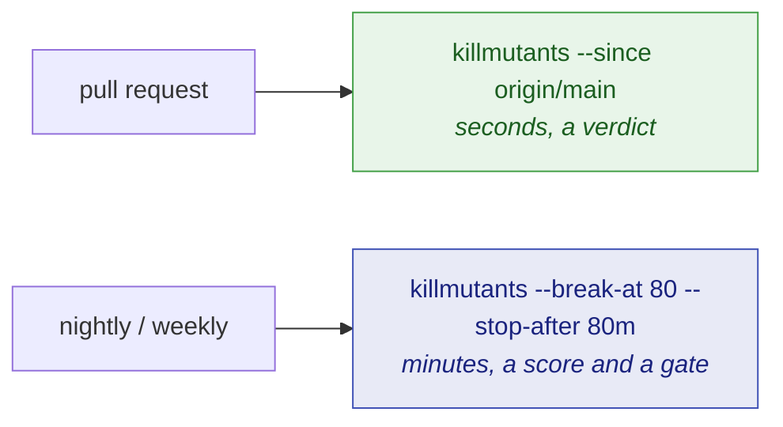
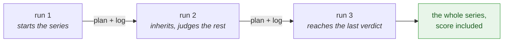

# Continuous integration

🌍 **Languages:**  
🇬🇧 English (this file) | 🇫🇷 [Français](./continuous-integration-fr.md)

Two jobs cover most teams: a fast one on every pull request, and a full sweep on a schedule. This
page builds both, then covers what a real pipeline runs into — a time budget, a project too large
for one job, a test project that targets several frameworks.

## The two jobs



**On a pull request**, judge the change and nothing else. The run takes seconds and exits `1` on an
undetected mutant; [Judging a pull request](./pull-requests-en.md) covers it.

```bash
killmutants --since origin/main --report-json artifacts/mutation.json
```

**On a schedule**, sweep the whole codebase with a gate:

```bash
killmutants --break-at 80 --report-json artifacts/mutation.json
```

`--break-at` exits `1` when the mutation score falls below the percentage. It is a comparison
against whatever families actually ran, so pick a catalogue and keep it
([The mutators](./mutators-en.md#choosing-a-catalogue)). A score that is *undefined* — no mutant
could be tested at all — fails the gate too: a run that demonstrated nothing cannot be shown to
have met a threshold, and reporting success would let a misconfigured job stay green for ever.

## A ready-made GitHub Actions job

```yaml
name: mutation

on:
  schedule:
    - cron: '30 2 * * *'
  workflow_dispatch:

jobs:
  mutate:
    runs-on: ubuntu-latest
    timeout-minutes: 90
    steps:
      - uses: actions/checkout@v4
      - uses: actions/setup-dotnet@v4
        with:
          dotnet-version: '10.0.x'

      - run: dotnet tool restore

      # The deadline sits below the job's timeout, with room to write the report.
      - run: dotnet killmutants --break-at 80 --stop-after 80m --report-json artifacts/mutation.json

      # Kept whatever happened: the log and the plan say what a killed run judged.
      - uses: actions/upload-artifact@v4
        if: always()
        with:
          name: mutation
          path: artifacts/
```

The repository's own [`selfcheck.yml`](../../.github/workflows/selfcheck.yml) is a working example,
with a step that turns the JSON report into a job summary.

## Pointing it at the right code

**The directory.** `killmutants [directory]` finds the xUnit 4 test projects beneath the directory,
then everything they reference. It defaults to the current one.

**What to leave out.** A real repository holds code a run has no business mutating — fixtures,
samples, generated files. `--exclude` takes it back out, and is repeatable:

```bash
killmutants --exclude "tests/fixtures/*" --exclude "*.Generated.cs"
```

A pattern is matched against the path relative to the directory being scanned, written with `/`;
`*` matches `/` as well, so `tests/*` covers everything beneath `tests`. An excluded project is left
out of the run entirely; an excluded file is still compiled but never mutated.
[The mutators](./mutators-en.md#leaving-code-alone) covers the two other ways —
`[ExcludeFromCodeCoverage]` and a test-support declaration.

**Which framework.** A test project may target several frameworks, and a score describes one build
of the code, so a run has to be told which. Without it the run stops and lists what each test
project offers; with it, every test project runs on that framework and the libraries follow the one
NuGet resolves for it:

```bash
killmutants --target-framework net10.0
```

One framework per run — run it again for another. A test project that does not offer the framework
stops the run too, rather than dropping out of the report unseen; `--exclude` sets it aside on
purpose ([DEC0021](../decisions/0021-the-developer-chooses-the-framework-the-test-projects-run-on-en.md)).

**Which configuration.** `--configuration` defaults to `Release`.

**How many at once.** `--parallel` defaults to half the processors. Each worker tests in a private
copy of the test output, so they never interfere.

## A run that outgrows its budget

A run that outgrows its CI budget should not take its measurements down with it. `--stop-after`
gives the run a deadline of its own; set it below the job's timeout, with room for the mutants still
in flight and for writing the report:

```bash
killmutants --stop-after 80m --report-json artifacts/mutation.json
```

When the deadline comes, the run stops testing and reports the verdicts it reached. Such a report
says it stopped, prints no score — the mutants it judged are the ones it reached first, not a
sample — and passes no gate: it exits `1` when `--break-at` or `--since` asked for one, and `0`
otherwise, with a line on standard error either way. Ctrl-C, SIGINT and SIGTERM stop it the same
way, and a second Ctrl-C ends it at once.

The deadline is the one that works on GitHub Actions, where a job's own timeout signals the step's
shell rather than the tool and kills everything seconds later
([DEC0013](../decisions/0013-a-stopped-run-reports-what-it-judged-and-passes-no-gate-en.md)).

**Nothing judged is ever lost.** Every verdict lands, the moment it is final, in a JSON Lines log
beside the report — the same path ending in `.jsonl` — and every run writes a plan beside it — the
same path ending in `.plan.json` — saying what it measured and which mutants it selected. A job
cancelled by a newer push, or a runner that was lost, still leaves *plan minus log*: what remained
to judge, readable without the tool. [Reading a report](./reading-a-report-en.md#the-files-beside-the-report)
describes both files.

## Finishing a large project over several runs

A project that does not fit in one budget is finished over several runs. `--resume <id>` makes the
run belong to a **series** named by the caller — the commit hash, typically:

```bash
killmutants --resume "$GITHUB_SHA" --stop-after 80m --report-json artifacts/mutation.json
```



The first run of a series starts it. A later run given the same name — on the same commit, with a
clean tree, pointed at the same directory, with the same settings and the same tool — inherits
every verdict the log holds and judges only the rest. A project with nothing left gets no sandbox,
no baseline and no coverage pass. The run that reaches the last verdict reports the whole series,
score included; until then each run is a stopped run, and exits as one.

Two verdicts are never inherited, because a stop can manufacture them: a **timeout**, which is only
final under the budget that confirmed it, and a **kill no test is named for**, which is what a test
host killed by the stop looks like.

What travels between jobs is the plan and the log — an artifact, or a cache keyed on the commit —
and the checkout has to stay on the series' commit until the series is done. A series of that name
on other code, or with other settings, is refused with the difference named and nothing touched.
Another name, or no name, over the same report path starts afresh
([DEC0015](../decisions/0015-a-resumed-run-inherits-the-verdicts-its-series-reached-on-the-same-code-en.md)).

### Files the tests themselves write

A series resumed **in the directory it was interrupted in** — on a workstation, typically — can find
files its own run wrote: a snapshot test writes a `.received` file beside its source when a mutant
changes its output. The refusal names the untracked files that appeared since the series began, and
the project can name them for good with `--ignore-untracked` (`ignoreUntracked` in
`killmutants.json`), which only a series takes:

```bash
killmutants --resume "$SHA" --report-json out/km.json \
  --ignore-untracked '*.received.html' --ignore-untracked '*.received.json'
```

Only untracked files under the directory are ignored, matched as `--exclude` matches; an edited
tracked file still makes the tree dirty. Every file ignored is named on standard error and recorded
in the report. A pattern that could cover a file that changes what is built is refused before
anything runs: one made only of wildcards, and any that can match the same path as `*.cs`,
`*.csproj`, `*.props`, `*.targets`, `*.globalconfig`, `*.resx`, `.editorconfig`, `global.json` or
`NuGet.config` — so `*.received.*` is refused, since it accepts `x.received.cs`, and the extensions
are named instead
([DEC0025](../decisions/0025-a-series-names-the-untracked-files-that-do-not-make-its-tree-dirty-en.md)).

## When part of the run cannot be measured

A project MSBuild cannot read, a test project that does not build, a suite that fails against
unmutated code, a coverage pass that fails: each is **set aside** with its reason, named at the top
of the report, and the rest of the run is measured as usual. Such a run passes no gate and exits
`2`, because what went wrong is in the environment or the suite, not in the tests — and `1` would
tell a job that the tests got weaker, which they did not
([DEC0022](../decisions/0022-a-run-carries-on-past-what-fails-and-reports-what-it-measured-and-what-it-could-not-en.md)).

A `--resume` run of the same series completes what was set aside once it is fixed.

## Trusting the kills

`--verify-kills <n>` tests `n` of the mutants reported killed a second time, on their own, and
reports any verdict that does not repeat. A verdict that does not survive its own repetition was
never a measurement — a flaky or order-dependent test produces a kill the mutation did not cause. It
costs one test run per sampled mutant; this repository re-verifies ten on every run.

## Keeping it all in a file

Every option above that states a habit has a key in `killmutants.json`, beside the code, so a CI
job stops retyping flags — and so the catalogue that produced a score is versioned with the code
that was scored. [Configuration](./configuration-en.md) lists every key.

## Where to go next

| If you want to… | Read |
| --- | --- |
| understand what a partial run selects and prints | [Judging a pull request](./pull-requests-en.md) |
| consume the JSON report, the log and the plan from a script | [Reading a report](./reading-a-report-en.md#the-json-report) |
| move the flags into `killmutants.json` | [Configuration](./configuration-en.md) |

---

[← Documentation index](../README.md)
