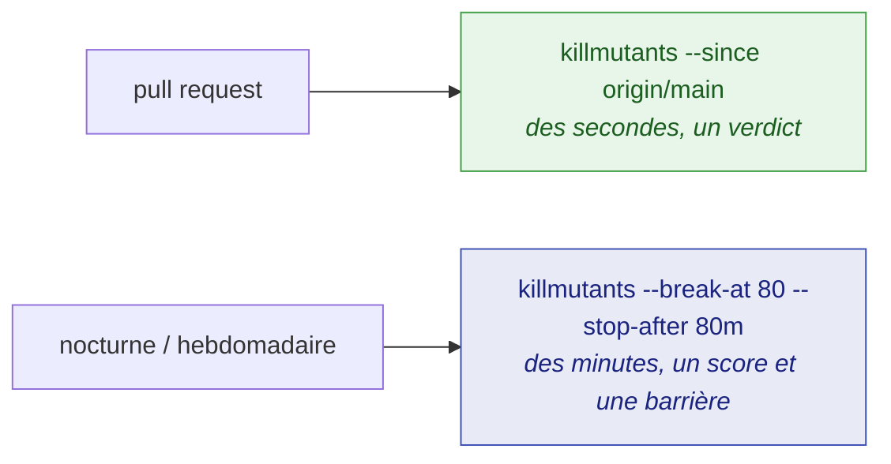

# Intégration continue

🌍 **Langues :**  
🇬🇧 [English](./continuous-integration-en.md) | 🇫🇷 Français (ce fichier)

Deux jobs suffisent à la plupart des équipes : un rapide sur chaque pull request, et un balayage
complet à heure fixe. Cette page construit les deux, puis couvre ce qu'un vrai pipeline rencontre —
un budget de temps, un projet trop gros pour un seul job, un projet de test qui cible plusieurs
frameworks.

## Les deux jobs



**Sur une pull request**, jugez le changement et rien d'autre. L'exécution prend quelques secondes
et sort avec le code `1` sur un mutant non détecté ; [Juger une pull request](./pull-requests-fr.md)
en traite.

```bash
killmutants --since origin/main --report-json artifacts/mutation.json
```

**À heure fixe**, balayez toute la base de code avec une barrière de qualité (gate) :

```bash
killmutants --break-at 80 --report-json artifacts/mutation.json
```

`--break-at` sort avec le code `1` quand le score de mutation tombe sous le pourcentage. C'est une
comparaison contre les familles qui ont effectivement été exécutées, alors choisissez un catalogue
et gardez-le ([Les mutateurs](./mutators-fr.md#choisir-un-catalogue)). Un score *indéfini* — aucun
mutant n'a pu être testé du tout — fait aussi échouer la barrière : une exécution qui n'a rien
démontré ne peut pas être présentée comme ayant atteint un seuil, et annoncer un succès laisserait
un job mal configuré au vert pour toujours.

## Un job GitHub Actions prêt à l'emploi

```yaml
name: mutation

on:
  schedule:
    - cron: '30 2 * * *'
  workflow_dispatch:

jobs:
  mutate:
    runs-on: ubuntu-latest
    timeout-minutes: 90
    steps:
      - uses: actions/checkout@v4
      - uses: actions/setup-dotnet@v4
        with:
          dotnet-version: '10.0.x'

      - run: dotnet tool restore

      # L'échéance se place sous le délai du job, avec de la marge pour écrire le rapport.
      - run: dotnet killmutants --break-at 80 --stop-after 80m --report-json artifacts/mutation.json

      # Conservé quoi qu'il arrive : le journal et le plan disent ce qu'une exécution tuée a jugé.
      - uses: actions/upload-artifact@v4
        if: always()
        with:
          name: mutation
          path: artifacts/
```

Le [`selfcheck.yml`](../../.github/workflows/selfcheck.yml) du dépôt lui-même est un exemple en
état de marche, avec une étape qui transforme le rapport JSON en résumé de job.

## Pointer vers le bon code

**Le répertoire.** `killmutants [directory]` trouve les projets de test xUnit 4 sous le répertoire,
puis tout ce qu'ils référencent. Par défaut, c'est le répertoire courant.

**Ce qu'il faut laisser de côté.** Un vrai dépôt contient du code qu'une exécution n'a aucune raison
de muter — des fixtures, des exemples, des fichiers générés. `--exclude` les retire, et se répète :

```bash
killmutants --exclude "tests/fixtures/*" --exclude "*.Generated.cs"
```

Un motif est confronté au chemin relatif au répertoire parcouru, écrit avec `/` ; `*` correspond
aussi à `/`, si bien que `tests/*` couvre tout ce qui se trouve sous `tests`. Un projet exclu est
laissé entièrement hors de l'exécution ; un fichier exclu est toujours compilé mais jamais muté.
[Les mutateurs](./mutators-fr.md#laisser-du-code-tranquille) couvre les deux autres façons —
`[ExcludeFromCodeCoverage]` et une déclaration de support de test.

**Quel framework.** Un projet de test peut cibler plusieurs frameworks, et un score décrit une seule
construction du code, si bien qu'il faut dire à l'exécution lequel. Sans cela, l'exécution s'arrête
et liste ce que chaque projet de test propose ; avec, chaque projet de test s'exécute sur ce
framework et les bibliothèques suivent celui que NuGet résout pour lui :

```bash
killmutants --target-framework net10.0
```

Un framework par exécution — relancez-la pour un autre. Un projet de test qui ne propose pas le
framework arrête lui aussi l'exécution, plutôt que de disparaître du rapport sans que personne ne le
voie ; `--exclude` le met de côté délibérément
([DEC0021](../decisions/0021-the-developer-chooses-the-framework-the-test-projects-run-on-fr.md)).

**Quelle configuration.** `--configuration` vaut `Release` par défaut.

**Combien à la fois.** `--parallel` vaut par défaut la moitié des processeurs. Chaque worker teste
dans une copie privée de la sortie de test, si bien qu'ils n'interfèrent jamais.

## Une exécution qui dépasse son budget

Une exécution qui dépasse son budget de CI ne devrait pas emporter ses mesures avec elle.
`--stop-after` donne à l'exécution une échéance qui lui est propre ; placez-la sous le délai du job,
avec de la marge pour les mutants encore en cours et pour l'écriture du rapport :

```bash
killmutants --stop-after 80m --report-json artifacts/mutation.json
```

Quand l'échéance arrive, l'exécution cesse de tester et rapporte les verdicts qu'elle a atteints. Un
tel rapport dit qu'il s'est interrompu, n'affiche aucun score — les mutants qu'il a jugés sont ceux
qu'il a atteints en premier, pas un échantillon — et ne passe aucune barrière : il sort avec le code
`1` quand `--break-at` ou `--since` en demandait une, et `0` sinon, avec une ligne sur la sortie
d'erreur standard dans les deux cas. Ctrl-C, SIGINT et SIGTERM l'interrompent de la même façon, et
un second Ctrl-C y met fin immédiatement.

L'échéance est ce qui fonctionne sur GitHub Actions, où le délai propre au job signale le shell de
l'étape plutôt que l'outil et tue tout quelques secondes plus tard
([DEC0013](../decisions/0013-a-stopped-run-reports-what-it-judged-and-passes-no-gate-fr.md)).

**Rien de ce qui a été jugé n'est jamais perdu.** Chaque verdict atterrit, dès qu'il est définitif,
dans un journal JSON Lines à côté du rapport — le même chemin terminé par `.jsonl` — et chaque
exécution écrit un plan à côté — le même chemin terminé par `.plan.json` — qui dit ce qu'elle a
mesuré et quels mutants elle a sélectionnés. Un job annulé par un push plus récent, ou un runner
perdu, laisse tout de même *le plan moins le journal* : ce qui restait à juger, lisible sans l'outil.
[Lire un rapport](./reading-a-report-fr.md#les-fichiers-à-côté-du-rapport) décrit les deux fichiers.

## Terminer un grand projet en plusieurs exécutions

Un projet qui ne tient pas dans un budget se termine en plusieurs exécutions. `--resume <id>`
rattache l'exécution à une **série** nommée par l'appelant — le hash du commit, typiquement :

```bash
killmutants --resume "$GITHUB_SHA" --stop-after 80m --report-json artifacts/mutation.json
```


La première exécution d'une série l'ouvre. Une exécution ultérieure qui reçoit le même nom — sur le
même commit, avec un arbre propre, pointée vers le même répertoire, avec les mêmes réglages et le
même outil — hérite de chaque verdict que le journal contient et ne juge que le reste. Un projet où
il ne reste rien n'a ni bac à sable, ni référence (baseline), ni passe de couverture. L'exécution
qui atteint le dernier verdict rapporte toute la série, score compris ; jusque-là, chaque exécution
est une exécution interrompue, et sort comme telle.

Deux verdicts ne sont jamais hérités, parce qu'un arrêt peut les fabriquer : un **délai dépassé
(timeout)**, qui n'est définitif que sous le budget qui l'a confirmé, et une **mise à mort qu'aucun
test ne revendique**, qui est exactement l'allure d'un hôte de test tué par l'arrêt.

Ce qui voyage entre les jobs, c'est le plan et le journal — un artefact, ou un cache indexé par le
commit — et le checkout doit rester sur le commit de la série jusqu'à ce que la série soit
terminée. Une série de ce nom sur un autre code, ou avec d'autres réglages, est refusée, la
différence nommée et rien touché. Un autre nom, ou aucun nom, sur le même chemin de rapport repart
de zéro
([DEC0015](../decisions/0015-a-resumed-run-inherits-the-verdicts-its-series-reached-on-the-same-code-fr.md)).

### Les fichiers que les tests écrivent eux-mêmes

Une série reprise **dans le répertoire où elle a été interrompue** — sur un poste de travail,
typiquement — peut y trouver des fichiers que sa propre exécution a écrits : un test de snapshot
écrit un fichier `.received` à côté de sa source quand un mutant change sa sortie. Le refus nomme
les fichiers non suivis apparus depuis le début de la série, et le projet peut les nommer une fois
pour toutes avec `--ignore-untracked` (`ignoreUntracked` dans `killmutants.json`), que seule une
série lit :

```bash
killmutants --resume "$SHA" --report-json out/km.json \
  --ignore-untracked '*.received.html' --ignore-untracked '*.received.json'
```

Seuls les fichiers non suivis sous le répertoire sont ignorés, confrontés au motif comme `--exclude`
le fait ; un fichier suivi modifié rend toujours l'arbre sale. Chaque fichier ignoré est nommé sur
la sortie d'erreur standard et consigné dans le rapport. Un motif qui pourrait couvrir un fichier
changeant ce qui est construit est refusé avant que quoi que ce soit ne s'exécute : un motif fait
uniquement de jokers, et tout motif pouvant correspondre au même chemin que `*.cs`, `*.csproj`,
`*.props`, `*.targets`, `*.globalconfig`, `*.resx`, `.editorconfig`, `global.json` ou
`NuGet.config` — si bien que `*.received.*` est refusé, puisqu'il accepte `x.received.cs`, et que
l'on nomme les extensions à la place
([DEC0025](../decisions/0025-a-series-names-the-untracked-files-that-do-not-make-its-tree-dirty-fr.md)).

## Quand une partie de l'exécution ne peut pas être mesurée

Un projet que MSBuild ne peut pas lire, un projet de test qui ne se construit pas, une suite qui
échoue sur du code non muté, une passe de couverture qui échoue : chacun est **mis de côté** avec
sa raison, nommé en tête du rapport, et le reste de l'exécution est mesuré comme d'habitude. Une
telle exécution ne passe aucune barrière et sort avec le code `2`, parce que ce qui a échoué se
trouve dans l'environnement ou dans la suite, pas dans les tests — et `1` dirait à un job que les
tests se sont affaiblis, ce qui n'est pas le cas
([DEC0022](../decisions/0022-a-run-carries-on-past-what-fails-and-reports-what-it-measured-and-what-it-could-not-fr.md)).

Une exécution `--resume` de la même série complète ce qui avait été mis de côté une fois que c'est
réparé.

## Faire confiance aux mises à mort

`--verify-kills <n>` teste une seconde fois, isolément, `n` des mutants rapportés tués, et signale
tout verdict qui ne se répète pas. Un verdict qui ne survit pas à sa propre répétition n'a jamais
été une mesure — un test instable, ou dépendant de l'ordre, produit une mise à mort que la mutation
n'a pas causée. Cela coûte une exécution de tests par mutant échantillonné ; ce dépôt en revérifie
dix à chaque exécution.

## Tout garder dans un fichier

Chaque option ci-dessus qui exprime une habitude a une clé dans `killmutants.json`, à côté du code,
pour qu'un job de CI cesse de retaper des options — et pour que le catalogue qui a produit un score
soit versionné avec le code qui a été noté. [Configuration](./configuration-fr.md) liste chaque
clé.

## Pour aller plus loin

| Si vous voulez… | Lisez |
| --- | --- |
| comprendre ce qu'une exécution partielle sélectionne et affiche | [Juger une pull request](./pull-requests-fr.md) |
| consommer le rapport JSON, le journal et le plan depuis un script | [Lire un rapport](./reading-a-report-fr.md#le-rapport-json) |
| déplacer les options dans `killmutants.json` | [Configuration](./configuration-fr.md) |

---

[← Index de la documentation](../README-fr.md)
