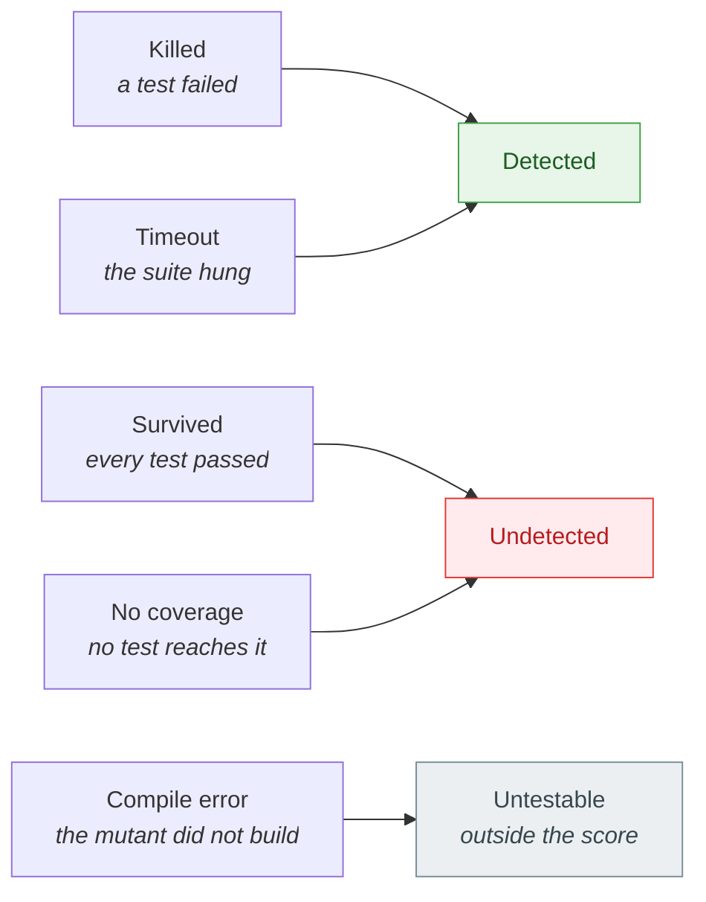

# Core concepts

🌍 **Languages:**  
🇬🇧 English (this file) | 🇫🇷 [Français](./core-concepts-fr.md)

Six ideas carry the whole tool. Once they are in place, every line of a report means something
precise, and the numbers stop being surprising.

## A mutant is one small change to your code

Mutation testing starts from a simple observation: a test that is worth anything fails when the code
it checks is wrong. So KillMutants makes the code wrong, in one small and deliberate way at a time,
and watches whether a test notices.

Each such change is a **mutant**. A mutant is always one node of the syntax tree replaced by
another — never two changes at once, and never a change that would not compile:

| Your code | The mutant | What it asks |
| --- | --- | --- |
| `age >= 18` | `age > 18` | is the boundary tested, or only somewhere around it? |
| `a && b` | `a \|\| b` | does a test withhold one of the two conditions? |
| `price * quantity` | `price / quantity` | does any test check the result, or only that it ran? |
| `return "adult";` | `return "";` | does any test read the text? |
| `register.Add(age);` | `{ }` | does any test observe the call's effect? |

The rule that produces a mutant is a **mutator**, and mutators are grouped in **families** —
`Comparison`, `LogicalOperator`, `Arithmetic`, `StringLiteral`, `Statement` and eleven more.
[The mutators](./mutators-en.md) lists them all.

## Five verdicts, three outcomes

Every mutant ends with one of five **statuses**, and each status has a **worth** — whether it
counts for or against the test suite. The two are kept apart on purpose, so that no reporter or
gate decides for itself what a timeout means.



| Status | What happened | Outcome |
| --- | --- | --- |
| **Killed** | at least one test failed against the mutant | detected |
| **Timeout** | the tests ran past their budget — the mutant made a loop infinite, say — and did so again when run alone | detected: the tests noticed, in their way |
| **Survived** | every test that reaches the mutant passed | **undetected**: the tests execute that code without checking it |
| **No coverage** | no test reaches the mutated line, so none was run | **undetected**: the suite would not have noticed either |
| **Compile error** | the mutated code did not build, which the mutators try hard to avoid | untestable: the suite was never asked |

The report lists the undetected mutants first, by file, because they are the findings. A survivor
names code your tests execute but do not check; an uncovered mutant names code they do not reach at
all — a different, and often more urgent, finding.

## The score, and why uncovered code counts

```text
mutation score = detected / (detected + undetected)
```

Only untestable mutants are left out, and only because the suite was never asked about them. A
mutant nothing covers **is** undetected: the suite would not have noticed the change, and skipping
its test run is an optimisation, not a pardon. Uncovered code therefore lowers the score — which is
the point. A project cannot raise its score by adding code that no test touches.

Two consequences follow:

* **A score is only comparable with a score from the same catalogue.** Leaving out
  `StringLiteral` asks a different question of the suite, and the number moves without a single
  test changing. Pick a catalogue for a CI job and keep it ([The mutators](./mutators-en.md#choosing-a-catalogue)).
* **Not every run has a score.** A run over a pull request's diff, or a run stopped before the
  end, judges a population no percentage can describe, so it prints a verdict or the counts
  instead ([Judging a pull request](./pull-requests-en.md),
  [Continuous integration](./continuous-integration-en.md)).

## How a run works

One run is a short, linear list of phases, each announced on standard error as it begins:


1. **Discover.** From the directory it was pointed at, KillMutants finds every xUnit 4 test
   project, then every project those reference, directly or through other projects. The second
   group is what gets mutated.
2. **Build.** The test projects are built once, so that their output exists before anything is
   injected into it.
3. **Analyse.** For each project under test, MSBuild is asked for the exact command line it hands
   the C# compiler, and that command line becomes an in-memory compilation. From here on, the
   `dotnet` build is never invoked again.
4. **Baseline.** The *unmutated* compilation is emitted, injected and tested, exactly as a mutant
   will be. The suite has to be green. A red baseline would make every mutant look killed, which is
   worse than no measurement, so a project whose baseline is red is set aside with its reason and
   the rest of the run carries on.
5. **Coverage.** Each test is run once, alone, against an instrumented build, to learn which
   mutants it reaches. From that map, a mutant nothing reaches gets its verdict without a test run,
   and every other mutant runs only the tests that can kill it.
6. **Test the mutants.** Each mutant is emitted, injected into a private copy of the test output,
   and the tests that reach it are run in a fresh process. A timeout is believed only once the
   mutant has timed out a second time, on its own. Finally, if asked, a sample of the kills is
   tested again, alone, and any verdict that does not repeat is reported.
7. **Report.** The findings, the counts, the per-family split and the score go to standard output;
   the same, in full, goes to the JSON report if one was asked for.

## One compilation and one process per mutant

Two choices make the verdicts trustworthy, and both are worth knowing because they are what most
other tools trade away for speed.

**Each mutant is its own compilation.** Rather than instrumenting your code once with every
mutation switched on and off at run time, KillMutants replaces one node in the syntax tree and
emits a new assembly. Roslyn makes that cost about six milliseconds; the test run that follows costs
a hundred times more. The trade buys simplicity — there is no injected switch, no activation
channel, nothing of the tool in your assembly — and it buys the next guarantee.

**Each mutant is tested in a fresh process, in a private directory.** The test host is never reused
between two mutants, and workers running in parallel each have their own copy of the test output.
So no static field, no cache, no file written by one mutant can ever leak into another's verdict —
the longest-standing source of inflated scores in tools that keep a warm host. It also means
KillMutants never writes into your build output at all.

## The timeout budget is written down

A mutant that turns a loop infinite has to be stopped, and the budget that stops it decides how many
mutants count as "detected" without a single test having failed. So the budget is never a hidden
constant: it is computed from your own suite and printed on the last line of every report.

```text
timeout budget 31.2 s (0.4 s baseline alone × 3 + 30 s)
```

The baseline is how long the unmutated suite took, run alone. The factor and the margin are fixed.
A reader who knows the suite takes half a second can see at a glance whether thirty-one seconds is
generous, and whether a timeout says something about the mutant or about the machine.

## What a run does not promise

* **No equivalence detection.** Some mutants cannot be killed by any test because they do not
  change the program's behaviour. The mutators avoid producing them wherever that can be known
  statically — a `+x` is never removed, a ternary with identical branches is left alone — but the
  general case is undecidable, and a surviving mutant is a finding to read, not a defect to fix
  blindly.
* **No score on a partial or stopped run.** The population is not one a percentage can describe,
  so none is printed ([DEC0010](../decisions/0010-a-partial-run-reports-findings-not-a-score-en.md),
  [DEC0013](../decisions/0013-a-stopped-run-reports-what-it-judged-and-passes-no-gate-en.md)).
* **No test framework but xUnit 4.** The coupling is a knowledge of the runner's command line, not
  a package reference, and no abstraction exists for another runner
  ([Design principles](./design-principles-en.md)).

## Where to go next

| If you want to… | Read |
| --- | --- |
| see every family and what it asks of your tests | [The mutators](./mutators-en.md) |
| understand every line of a report | [Reading a report](./reading-a-report-en.md) |
| run it on a pull request rather than nightly | [Judging a pull request](./pull-requests-en.md) |
| know why the tool refuses some things on purpose | [Design principles](./design-principles-en.md) |

---

[← Documentation index](../README.md)
