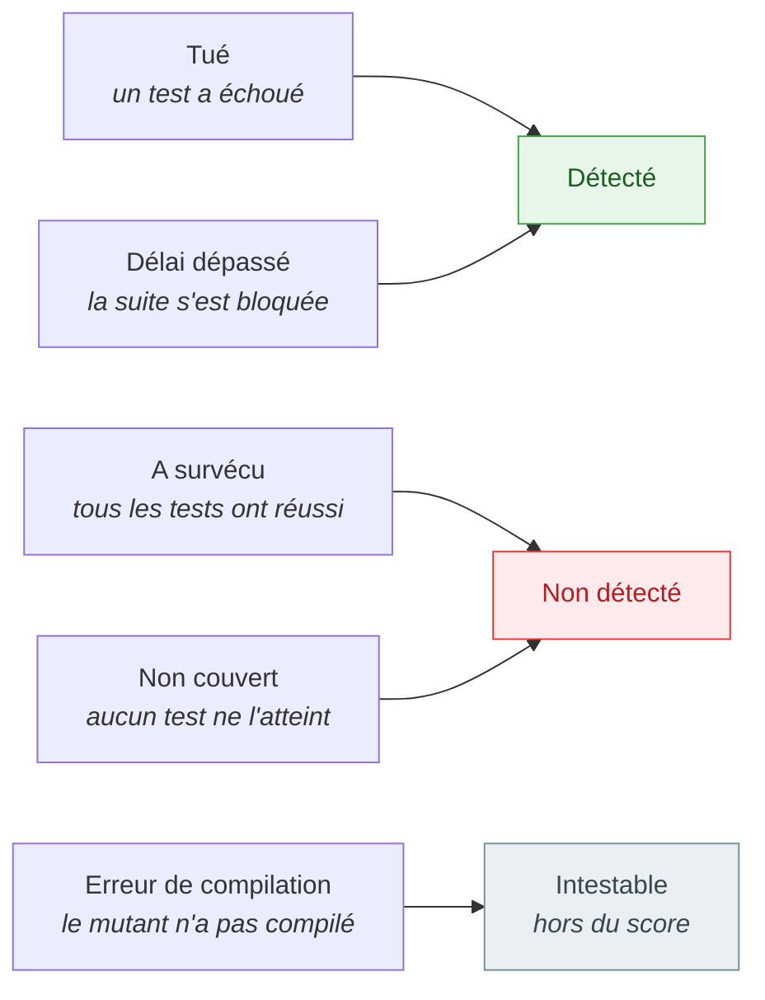

# Concepts fondamentaux

🌍 **Langues :**  
🇬🇧 [English](./core-concepts-en.md) | 🇫🇷 Français (ce fichier)

Six idées portent tout l'outil. Une fois qu'elles sont en place, chaque ligne d'un rapport a un
sens précis, et les nombres cessent de surprendre.

## Un mutant est une petite modification de votre code

Le mutation testing part d'une observation simple : un test qui vaut quelque chose échoue quand le
code qu'il vérifie est faux. KillMutants rend donc le code faux, d'une petite manière délibérée à la
fois, et regarde si un test s'en aperçoit.

Chacune de ces modifications est un **mutant**. Un mutant est toujours un nœud de l'arbre
syntaxique remplacé par un autre — jamais deux modifications à la fois, et jamais une modification
qui ne compilerait pas :

| Votre code | Le mutant | Ce qu'il demande |
| --- | --- | --- |
| `age >= 18` | `age > 18` | la limite est-elle testée, ou seulement ses alentours ? |
| `a && b` | `a \|\| b` | existe-t-il un test où l'une des deux conditions manque ? |
| `price * quantity` | `price / quantity` | un test vérifie-t-il le résultat, ou seulement que le calcul a eu lieu ? |
| `return "adult";` | `return "";` | un test lit-il le texte ? |
| `register.Add(age);` | `{ }` | un test observe-t-il l'effet de l'appel ? |

La règle qui produit un mutant est un **mutateur**, et les mutateurs sont regroupés en
**familles** — `Comparison`, `LogicalOperator`, `Arithmetic`, `StringLiteral`, `Statement` et onze
autres. [Les mutateurs](./mutators-fr.md) les recense toutes.

## Cinq verdicts, trois issues

Chaque mutant finit avec l'un de cinq **statuts**, et chaque statut a une **valeur** — compte-t-il
pour ou contre la suite de tests. Les deux sont tenus séparés à dessein, pour qu'aucun rapporteur
ni aucune barrière de qualité (gate) ne décide de son propre chef de ce que signifie un délai
dépassé.



| Statut | Ce qui s'est passé | Issue |
| --- | --- | --- |
| **Tué** | au moins un test a échoué face au mutant | détecté |
| **Délai dépassé (timeout)** | les tests ont dépassé leur budget — le mutant a rendu une boucle infinie, par exemple — et l'ont dépassé de nouveau en étant relancés seuls | détecté : les tests s'en sont aperçus, à leur manière |
| **A survécu** | tous les tests qui atteignent le mutant ont réussi | **non détecté** : les tests exécutent ce code sans le vérifier |
| **Non couvert** | aucun test n'atteint la ligne mutée, donc aucun n'a été lancé | **non détecté** : la suite ne s'en serait pas aperçue non plus |
| **Erreur de compilation** | le code muté n'a pas compilé, ce que les mutateurs s'efforcent d'éviter | intestable : la suite n'a jamais été interrogée |

Le rapport liste d'abord les mutants non détectés, par fichier, parce que ce sont eux les constats.
Un survivant désigne du code que vos tests exécutent sans le vérifier ; un mutant non couvert
désigne du code qu'ils n'atteignent pas du tout — un constat différent, et souvent plus urgent.

## Le score, et pourquoi le code non couvert compte

```text
mutation score = detected / (detected + undetected)
```

Seuls les mutants intestables sont laissés de côté, et seulement parce que la suite n'a jamais été
interrogée à leur sujet. Un mutant que rien ne couvre **est** non détecté : la suite ne se serait
pas aperçue de la modification, et sauter son exécution de tests est une optimisation, pas une
grâce. Le code non couvert fait donc baisser le score — c'est le but. Un projet ne peut pas faire
monter son score en ajoutant du code qu'aucun test ne touche.

Deux conséquences en découlent :

* **Un score n'est comparable qu'à un score issu du même catalogue.** Laisser `StringLiteral` de
  côté pose une autre question à la suite, et le nombre bouge sans qu'un seul test ait changé.
  Choisissez un catalogue pour un job de CI et gardez-le
  ([Les mutateurs](./mutators-fr.md#choisir-un-catalogue)).
* **Toutes les exécutions n'ont pas de score.** Une exécution sur le diff d'une pull request, ou
  une exécution interrompue avant la fin, juge une population qu'aucun pourcentage ne peut décrire,
  et affiche donc un verdict ou les comptes à la place
  ([Juger une pull request](./pull-requests-fr.md),
  [Intégration continue](./continuous-integration-fr.md)).

## Comment se déroule une exécution

Une exécution est une courte liste linéaire de phases, chacune annoncée sur la sortie d'erreur
standard au moment où elle commence :


1. **Découvrir.** À partir du répertoire qu'on lui indique, KillMutants trouve chaque projet de
   test xUnit 4, puis chaque projet que ceux-ci référencent, directement ou à travers d'autres
   projets. Le second groupe est ce qui sera muté.
2. **Construire.** Les projets de test sont construits une fois, pour que leur sortie existe avant
   qu'on y injecte quoi que ce soit.
3. **Analyser.** Pour chaque projet testé, on demande à MSBuild la ligne de commande exacte qu'il
   transmet au compilateur C#, et cette ligne de commande devient une compilation en mémoire. À
   partir de là, le build `dotnet` n'est plus jamais invoqué.
4. **Référence.** La compilation *non mutée* — la référence (« baseline ») — est émise, injectée et
   testée, exactement comme le sera un mutant. La suite doit être verte. Une référence rouge ferait
   passer chaque mutant pour tué, ce qui est pire qu'aucune mesure ; un projet dont la référence
   est rouge est donc mis de côté avec sa raison, et le reste de l'exécution continue.
5. **Couverture.** Chaque test est lancé une fois, seul, contre un build instrumenté, pour apprendre
   quels mutants il atteint. À partir de cette carte, un mutant que rien n'atteint reçoit son
   verdict sans qu'un test soit lancé, et chaque autre mutant ne lance que les tests capables de le
   tuer.
6. **Tester les mutants.** Chaque mutant est émis, injecté dans une copie privée de la sortie des
   tests, et les tests qui l'atteignent sont lancés dans un processus neuf. Un délai dépassé n'est
   cru qu'une fois que le mutant a dépassé le délai une seconde fois, seul. Enfin, si on le demande,
   un échantillon des mutants tués est testé de nouveau, seul, et tout verdict qui ne se répète pas
   est signalé.
7. **Rapporter.** Les constats, les comptes, la répartition par famille et le score vont sur la
   sortie standard ; la même chose, en entier, va dans le rapport JSON si on en a demandé un.

## Une compilation et un processus par mutant

Deux choix rendent les verdicts dignes de confiance, et tous deux valent d'être connus parce que ce
sont ceux que la plupart des autres outils sacrifient à la vitesse.

**Chaque mutant est sa propre compilation.** Plutôt que d'instrumenter votre code une fois avec
toutes les mutations activables et désactivables à l'exécution, KillMutants remplace un nœud dans
l'arbre syntaxique et émet un nouvel assembly. Roslyn ramène ce coût à six millisecondes environ ;
l'exécution des tests qui suit coûte cent fois plus. Ce choix achète la simplicité — pas
d'interrupteur injecté, pas de canal d'activation, rien de l'outil dans votre assembly — et il
achète la garantie suivante.

**Chaque mutant est testé dans un processus neuf, dans un répertoire privé.** L'hôte de test n'est
jamais réutilisé entre deux mutants, et les workers qui tournent en parallèle ont chacun leur
propre copie de la sortie des tests. Ainsi aucun champ statique, aucun cache, aucun fichier écrit
par un mutant ne peut jamais fuir dans le verdict d'un autre — la plus ancienne source de scores
gonflés dans les outils qui gardent un hôte chaud. Cela signifie aussi que KillMutants n'écrit
jamais dans votre sortie de build.

## Le budget de délai est écrit noir sur blanc

Un mutant qui rend une boucle infinie doit être arrêté, et le budget qui l'arrête décide combien de
mutants comptent comme « détectés » sans qu'un seul test ait échoué. Le budget n'est donc jamais
une constante cachée : il est calculé à partir de votre propre suite et imprimé sur la dernière
ligne de chaque rapport.

```text
timeout budget 31.2 s (0.4 s baseline alone × 3 + 30 s)
```

La référence (`baseline`) est le temps qu'a pris la suite non mutée, lancée seule. Le facteur et la
marge sont fixes. Un lecteur qui sait que la suite prend une demi-seconde voit d'un coup d'œil si
trente et une secondes sont généreuses, et si un délai dépassé dit quelque chose du mutant ou de la
machine.

## Ce qu'une exécution ne promet pas

* **Pas de détection d'équivalence.** Certains mutants ne peuvent être tués par aucun test parce
  qu'ils ne changent pas le comportement du programme. Les mutateurs évitent d'en produire partout
  où cela se sait statiquement — un `+x` n'est jamais retiré, un ternaire aux branches identiques
  est laissé intact — mais le cas général est indécidable, et un mutant survivant est un constat à
  lire, pas un défaut à corriger aveuglément.
* **Pas de score sur une exécution partielle ou interrompue.** La population n'est pas de celles
  qu'un pourcentage peut décrire, donc aucun n'est imprimé
  ([DEC0010](../decisions/0010-a-partial-run-reports-findings-not-a-score-fr.md),
  [DEC0013](../decisions/0013-a-stopped-run-reports-what-it-judged-and-passes-no-gate-fr.md)).
* **Aucun framework de test autre que xUnit 4.** Le couplage est la connaissance de la ligne de
  commande du runner, pas une référence de paquet, et aucune abstraction n'existe pour un autre
  runner ([Principes de conception](./design-principles-fr.md)).

## Pour aller plus loin

| Si vous voulez… | Lisez |
| --- | --- |
| voir chaque famille et ce qu'elle demande à vos tests | [Les mutateurs](./mutators-fr.md) |
| comprendre chaque ligne d'un rapport | [Lire un rapport](./reading-a-report-fr.md) |
| le lancer sur une pull request plutôt que chaque nuit | [Juger une pull request](./pull-requests-fr.md) |
| savoir pourquoi l'outil refuse certaines choses à dessein | [Principes de conception](./design-principles-fr.md) |

---

[← Index de la documentation](../README-fr.md)
