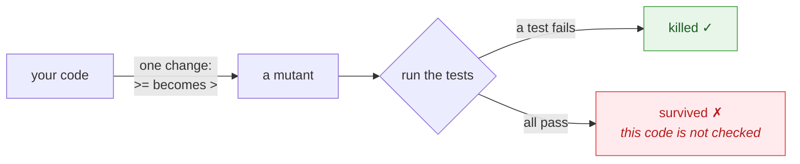

# Getting started

🌍 **Languages:**  
🇬🇧 English (this file) | 🇫🇷 [Français](./getting-started-fr.md)

In ten minutes, this page takes you from installing KillMutants to running it on a project, reading
its first report, and killing your first survivor. No prior knowledge of mutation testing is
required.

## What is a mutant?

A **mutant** is your code with one small, deliberate mistake in it.

Take a shipping rule: orders of 100 or more ship free.

```csharp
public static decimal FeeFor(decimal orderTotal)
{
    return orderTotal >= 100m ? 0m : 4.90m;
}
```

And two tests, which pass and cover every line:

```csharp
[Fact]
public void Shipping_is_free_on_a_large_order()
{
    Assert.Equal(0m, Shipping.FeeFor(150m));
}

[Fact]
public void Shipping_is_charged_on_a_small_order()
{
    Assert.Equal(4.90m, Shipping.FeeFor(50m));
}
```

Now imagine `>=` becomes `>`. The rule is wrong: an order of exactly 100 is charged. Yet 150 still
ships free and 50 is still charged, so **both tests still pass**. Coverage said the line was
executed. It never said the line was checked.

That changed program is a mutant. KillMutants builds it — and a dozen others — runs your tests
against each, and tells you which ones your tests failed to notice:



A mutant your tests catch is **killed**. One they miss **survives**, and the report names it to the
character. That is the whole idea; [Core concepts](./core-concepts-en.md) has the rest of the
vocabulary.

## Install

KillMutants is a `dotnet` tool. It is not on nuget.org yet, so you pack it from a clone of its
repository and install it from the folder you packed into. The packing happens in that clone; the
install itself can run from anywhere:

```bash
git clone https://github.com/Reefact/kill-mutants
cd kill-mutants
dotnet pack src/KillMutants.Cli -c Release -o ./artifacts
dotnet tool install --global KillMutants --add-source ./artifacts --prerelease
```

Prefer a tool that travels with one repository? Leave the clone, go to the root of **your**
repository, and record the tool in the manifest there. The package source is then the folder you
packed into, written as a path, since `./artifacts` no longer means anything from here:

```bash
cd /path/to/your-repository
dotnet new tool-manifest
dotnet tool install KillMutants --add-source /path/to/kill-mutants/artifacts --prerelease
dotnet killmutants
```

The manifest records the package and its version, not where it came from. Whoever runs
`dotnet tool restore` next — a colleague, a CI job — needs the same package source within reach,
which for now means packing the tool first
([Continuous integration](./continuous-integration-en.md#a-ready-made-github-actions-job) shows how).

Nothing is added to your test projects: no package, no attribute, no base class. The only
requirement is that your tests run on **xUnit 4** — the `xunit.v3` package family at version 4,
Microsoft Testing Platform flavour included — on modern .NET, in SDK-style projects.

## A project to try it on

The walk-through below uses a two-project solution small enough to read in full. Yours works the
same way; only the numbers change.

```text
Shop/
  Shipping.cs        FeeFor(orderTotal) and IsExpress(weight, customerAskedForIt)
  Labels.cs          For(orderTotal): "Free shipping" or "Standard shipping"
Shop.Tests/
  ShippingTests.cs   the two tests above, plus one for IsExpress
```

Nobody wrote a test for `Labels`. Keep that in mind.

## Your first run

From the root of the solution:

```bash
killmutants
```

Progress goes to standard error, one dated line per phase, so a redirected report stays clean:

```text
21:05:32  Discovering projects
21:05:33  Building test projects — Shop.Tests
21:05:35  Analysing — Shop
21:05:38  Verifying the baseline — Shop
21:05:40  Measuring coverage
21:05:41  Testing mutants
```

Those six lines are the whole method. KillMutants found the test project and the project it
references, built the tests once, read the compiler's own command line to rebuild `Shop` in memory,
checked that the *unmutated* code passes its own tests, worked out which test reaches which line,
and only then started testing mutants — each in its own process, several at a time.

## Reading the report

The report goes to standard output. Eleven seconds later, here it is in full:

```text
KillMutants

Survived (2)

  Shipping.cs
     7:16  orderTotal >= 100m    -> orderTotal > 100m     [Comparison]
    12:38  weightInGrams <= 2000 -> weightInGrams < 2000  [Comparison]

No coverage (5)

  Labels.cs
    7:16  Shipping.FeeFor(orderTotal) == 0m ? "Free shipping" : "Stan… -> ((Shipping.FeeFor(orderTotal) == 0m) || true) ? "Free shipp…  [Conditional]
    7:16  Shipping.FeeFor(orderTotal) == 0m ? "Free shipping" : "Stan… -> ((Shipping.FeeFor(orderTotal) == 0m) && false) ? "Free ship…  [Conditional]
    7:16  Shipping.FeeFor(orderTotal) == 0m                            -> Shipping.FeeFor(orderTotal) != 0m                             [Comparison]
    7:52  "Free shipping"                                              -> ""                                                            [StringLiteral]
    7:70  "Standard shipping"                                          -> ""                                                            [StringLiteral]

Mutants: 13
Killed: 6
Survived: 2
No coverage: 5

By mutator

  Comparison       5 mutants, 2 detected  (40%)
  Conditional      4 mutants, 2 detected  (50%)
  StringLiteral    2 mutants, 0 detected  (0%)
  LogicalOperator  1 mutant, 1 detected  (100%)
  NegatedDecision  1 mutant, 1 detected  (100%)

Mutation score: 46.15%
Elapsed: 11.1 s
Per mutant: median 0.6 s, slowest 1.4 s (Shipping.cs:12, Comparison)
Ran on: .NET 10.0.14 on Ubuntu 24.04.5 LTS, 2 of 4 processors, xUnit 4.0.0, timeout budget 31.2 s (0.4 s baseline alone × 3 + 30 s), no kills re-verified
```

Read it top down; the findings come first because they are the point.

**Survived (2)** — the mutants your tests let through. Each line is a file position, the original
code, the mutated code, and the family that produced it. `7:16` in `Shipping.cs` is our `>=`: the
tests never try an order of exactly 100. `12:38` is the same story on the express rule's weight
limit.

**No coverage (5)** — mutants no test reaches at all. Every one is in `Labels.cs`, which is exactly
the file nobody tested. These count against the score just like survivors, because the suite would
not have noticed any of them either.

**The counts.** Thirteen mutants were generated; six were killed; seven were not.

**By mutator.** What each family produced and what your tests caught. `StringLiteral` scored 0 %
here only because both of its mutants are in the untested file.

**Mutation score: 46.15 %.** Detected over detected plus undetected: 6 / 13. Uncovered mutants
count as undetected, so the untested file weighs on the number — which is the point.

**Ran on.** Everything a reader needs to compare this run with another one, including the budget
after which a mutant is declared a timeout, written as the formula it is.

## Killing your first survivor

The first survivor asks a precise question: *what happens at exactly 100?* Write the test that
answers it:

```csharp
[Fact]
public void Shipping_is_free_from_exactly_one_hundred()
{
    Assert.Equal(0m, Shipping.FeeFor(100m));
}
```

Run again:

```text
Survived (1)

  Shipping.cs
    12:38  weightInGrams <= 2000 -> weightInGrams < 2000  [Comparison]

...

Mutants: 13
Killed: 7
Survived: 1
No coverage: 5

Mutation score: 53.85%
```

One line gone, one more kill, and a test that will now fail the day someone types `>` instead of
`>=`. The second survivor wants the same treatment — a parcel of exactly 2000 grams — and the five
uncovered mutants want a test for `Labels` at all.

That is the loop: **run, read the first finding, write the test it asks for.** Nothing in the
report is a verdict on you; each line is a test you have not written yet, with its file and line
attached.

## Where to go next

| If you want to… | Read |
| --- | --- |
| understand every status and how the score is computed | [Core concepts](./core-concepts-en.md) |
| see what each mutator family asks of your tests | [The mutators](./mutators-en.md) |
| read a long report without missing anything, or consume it from a script | [Reading a report](./reading-a-report-en.md) |
| run it on a pull request, in seconds | [Judging a pull request](./pull-requests-en.md) |
| put it in CI with a gate and a time budget | [Continuous integration](./continuous-integration-en.md) |
| keep the options in a file beside the code | [Configuration](./configuration-en.md) |

---

[← Documentation index](../README.md)
