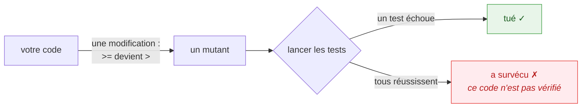

# Démarrer

🌍 **Langues :**  
🇬🇧 [English](./getting-started-en.md) | 🇫🇷 Français (ce fichier)

En dix minutes, cette page vous mène de l'installation de KillMutants à son exécution sur un projet,
à la lecture de son premier rapport et à votre premier survivant tué. Aucune connaissance préalable
du mutation testing n'est requise.

## Qu'est-ce qu'un mutant ?

Un **mutant** est votre code avec une petite erreur délibérée dedans.

Prenez une règle de livraison : les commandes de 100 ou plus sont livrées gratuitement.

```csharp
public static decimal FeeFor(decimal orderTotal)
{
    return orderTotal >= 100m ? 0m : 4.90m;
}
```

Et deux tests, qui réussissent et couvrent chaque ligne :

```csharp
[Fact]
public void Shipping_is_free_on_a_large_order()
{
    Assert.Equal(0m, Shipping.FeeFor(150m));
}

[Fact]
public void Shipping_is_charged_on_a_small_order()
{
    Assert.Equal(4.90m, Shipping.FeeFor(50m));
}
```

Imaginez maintenant que `>=` devienne `>`. La règle est fausse : une commande d'exactement 100 est
facturée. Pourtant 150 est toujours livrée gratuitement et 50 est toujours facturée, donc **les deux
tests réussissent encore**. La couverture disait que la ligne était exécutée. Elle n'a jamais dit
que la ligne était vérifiée.

Ce programme modifié est un mutant. KillMutants le construit — avec une douzaine d'autres —, lance
vos tests contre chacun, et vous dit lesquels vos tests n'ont pas remarqués :



Un mutant que vos tests attrapent est **tué**. Un qu'ils manquent **survit**, et le rapport le
désigne au caractère près. C'est toute l'idée ; [Concepts fondamentaux](./core-concepts-fr.md) a le
reste du vocabulaire.

## Installer

KillMutants est un outil `dotnet`. Il n'est pas encore sur nuget.org : vous l'empaquetez donc depuis
un clone de son dépôt et vous l'installez depuis le dossier dans lequel vous l'avez empaqueté.
L'empaquetage se fait dans ce clone ; l'installation, elle, peut se lancer de n'importe où :

```bash
git clone https://github.com/Reefact/kill-mutants
cd kill-mutants
dotnet pack src/KillMutants.Cli -c Release -o ./artifacts
dotnet tool install --global KillMutants --add-source ./artifacts --prerelease
```

Vous préférez un outil qui voyage avec un seul dépôt ? Quittez le clone, placez-vous à la racine de
**votre** dépôt et consignez l'outil dans le manifeste qui s'y trouve. La source de paquets est alors
le dossier dans lequel vous avez empaqueté, écrit comme un chemin, puisque `./artifacts` ne veut plus
rien dire d'ici :

```bash
cd /path/to/your-repository
dotnet new tool-manifest
dotnet tool install KillMutants --add-source /path/to/kill-mutants/artifacts --prerelease
dotnet killmutants
```

Le manifeste consigne le paquet et sa version, pas son origine. Quiconque lance ensuite
`dotnet tool restore` — un collègue, un job de CI — a besoin que la même source de paquets soit à
portée, ce qui, pour l'instant, veut dire empaqueter l'outil d'abord
([Intégration continue](./continuous-integration-fr.md#un-job-github-actions-prêt-à-lemploi) montre comment).

Rien n'est ajouté à vos projets de test : ni paquet, ni attribut, ni classe de base. La seule
exigence est que vos tests tournent sur **xUnit 4** — la famille de paquets `xunit.v3` en version 4,
déclinaison Microsoft Testing Platform comprise — sur .NET moderne, dans des projets au format SDK.

## Un projet pour l'essayer

Le parcours ci-dessous utilise une solution à deux projets, assez petite pour être lue en entier.
La vôtre fonctionne de la même façon ; seuls les nombres changent.

```text
Shop/
  Shipping.cs        FeeFor(orderTotal) and IsExpress(weight, customerAskedForIt)
  Labels.cs          For(orderTotal): "Free shipping" or "Standard shipping"
Shop.Tests/
  ShippingTests.cs   the two tests above, plus one for IsExpress
```

Personne n'a écrit de test pour `Labels`. Gardez-le en tête.

## Votre première exécution

Depuis la racine de la solution :

```bash
killmutants
```

La progression va sur la sortie d'erreur standard, une ligne datée par phase, pour qu'un rapport
redirigé reste propre :

```text
21:05:32  Discovering projects
21:05:33  Building test projects — Shop.Tests
21:05:35  Analysing — Shop
21:05:38  Verifying the baseline — Shop
21:05:40  Measuring coverage
21:05:41  Testing mutants
```

Ces six lignes sont toute la méthode. KillMutants a trouvé le projet de test et le projet qu'il
référence, construit les tests une fois, lu la ligne de commande du compilateur lui-même pour
reconstruire `Shop` en mémoire, vérifié que le code *non muté* réussit ses propres tests, déterminé
quel test atteint quelle ligne, et seulement alors commencé à tester les mutants — chacun dans son
propre processus, plusieurs à la fois.

## Lire le rapport

Le rapport va sur la sortie standard. Onze secondes plus tard, le voici en entier :

```text
KillMutants

Survived (2)

  Shipping.cs
     7:16  orderTotal >= 100m    -> orderTotal > 100m     [Comparison]
    12:38  weightInGrams <= 2000 -> weightInGrams < 2000  [Comparison]

No coverage (5)

  Labels.cs
    7:16  Shipping.FeeFor(orderTotal) == 0m ? "Free shipping" : "Stan… -> ((Shipping.FeeFor(orderTotal) == 0m) || true) ? "Free shipp…  [Conditional]
    7:16  Shipping.FeeFor(orderTotal) == 0m ? "Free shipping" : "Stan… -> ((Shipping.FeeFor(orderTotal) == 0m) && false) ? "Free ship…  [Conditional]
    7:16  Shipping.FeeFor(orderTotal) == 0m                            -> Shipping.FeeFor(orderTotal) != 0m                             [Comparison]
    7:52  "Free shipping"                                              -> ""                                                            [StringLiteral]
    7:70  "Standard shipping"                                          -> ""                                                            [StringLiteral]

Mutants: 13
Killed: 6
Survived: 2
No coverage: 5

By mutator

  Comparison       5 mutants, 2 detected  (40%)
  Conditional      4 mutants, 2 detected  (50%)
  StringLiteral    2 mutants, 0 detected  (0%)
  LogicalOperator  1 mutant, 1 detected  (100%)
  NegatedDecision  1 mutant, 1 detected  (100%)

Mutation score: 46.15%
Elapsed: 11.1 s
Per mutant: median 0.6 s, slowest 1.4 s (Shipping.cs:12, Comparison)
Ran on: .NET 10.0.14 on Ubuntu 24.04.5 LTS, 2 of 4 processors, xUnit 4.0.0, timeout budget 31.2 s (0.4 s baseline alone × 3 + 30 s), no kills re-verified
```

Lisez-le de haut en bas ; les constats viennent d'abord parce que ce sont eux qui comptent.

**Survived (2)** — les mutants que vos tests ont laissés passer. Chaque ligne est une position dans
un fichier, le code d'origine, le code muté, et la famille qui l'a produit. `7:16` dans
`Shipping.cs` est notre `>=` : les tests n'essaient jamais une commande d'exactement 100. `12:38`
est la même histoire sur la limite de poids de la règle express.

**No coverage (5)** — des mutants qu'aucun test n'atteint. Tous sont dans `Labels.cs`, qui est
précisément le fichier que personne n'a testé. Ils comptent contre le score exactement comme les
survivants, parce que la suite ne se serait aperçue d'aucun d'eux non plus.

**Les comptes.** Treize mutants ont été générés ; six ont été tués ; sept ne l'ont pas été.

**By mutator.** Ce que chaque famille a produit et ce que vos tests ont attrapé. `StringLiteral`
n'obtient 0 % ici que parce que ses deux mutants sont dans le fichier non testé.

**Mutation score : 46,15 %.** Détectés sur détectés plus non détectés : 6 / 13. Les mutants non
couverts comptent comme non détectés, donc le fichier non testé pèse sur le nombre — c'est le but.

**Ran on.** Tout ce dont un lecteur a besoin pour comparer cette exécution à une autre, y compris
le budget au-delà duquel un mutant est déclaré en délai dépassé, écrit sous la forme de la formule
qu'il est.

## Tuer votre premier survivant

Le premier survivant pose une question précise : *que se passe-t-il à exactement 100 ?* Écrivez le
test qui y répond :

```csharp
[Fact]
public void Shipping_is_free_from_exactly_one_hundred()
{
    Assert.Equal(0m, Shipping.FeeFor(100m));
}
```

Relancez :

```text
Survived (1)

  Shipping.cs
    12:38  weightInGrams <= 2000 -> weightInGrams < 2000  [Comparison]

...

Mutants: 13
Killed: 7
Survived: 1
No coverage: 5

Mutation score: 53.85%
```

Une ligne en moins, un mutant tué de plus, et un test qui échouera désormais le jour où quelqu'un
tapera `>` au lieu de `>=`. Le second survivant réclame le même traitement — un colis d'exactement
2000 grammes — et les cinq mutants non couverts réclament, tout simplement, un test pour `Labels`.

C'est la boucle : **lancer, lire le premier constat, écrire le test qu'il demande.** Rien dans le
rapport n'est un verdict sur vous ; chaque ligne est un test que vous n'avez pas encore écrit, avec
son fichier et sa ligne.

## Pour aller plus loin

| Si vous voulez… | Lisez |
| --- | --- |
| comprendre chaque statut et comment le score est calculé | [Concepts fondamentaux](./core-concepts-fr.md) |
| voir ce que chaque famille de mutateurs demande à vos tests | [Les mutateurs](./mutators-fr.md) |
| lire un long rapport sans rien manquer, ou l'exploiter depuis un script | [Lire un rapport](./reading-a-report-fr.md) |
| le lancer sur une pull request, en quelques secondes | [Juger une pull request](./pull-requests-fr.md) |
| le mettre en CI avec une barrière de qualité et un budget de temps | [Intégration continue](./continuous-integration-fr.md) |
| garder les options dans un fichier à côté du code | [Configuration](./configuration-fr.md) |

---

[← Index de la documentation](../README-fr.md)
