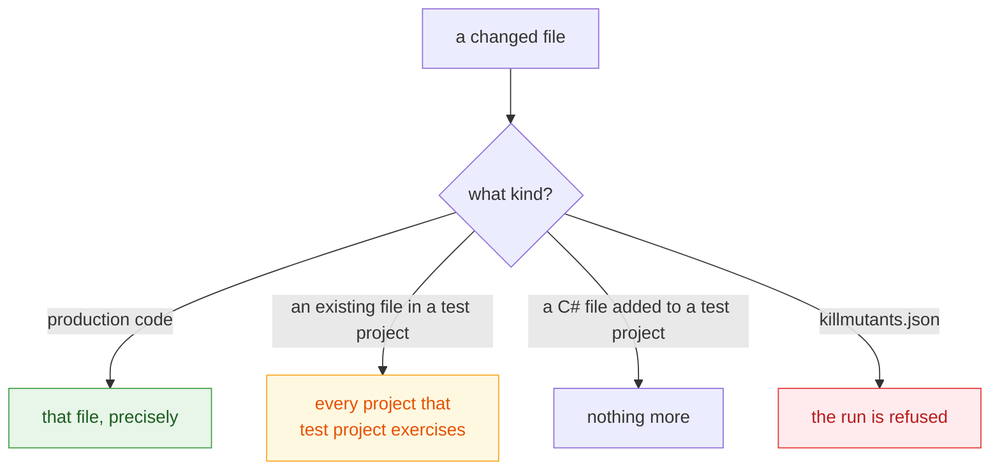

# Judging a pull request

🌍 **Languages:**  
🇬🇧 English (this file) | 🇫🇷 [Français](./pull-requests-fr.md)

A full sweep of a real repository takes minutes; a diff takes seconds. `--since` runs only what a
change touched, which is what makes mutation testing usable on every pull request rather than once
a night. This page says what such a run selects, what it prints, and when it refuses to answer.

## One option

```bash
killmutants --since origin/main
```

The change is measured from the **merge base** of that revision and `HEAD` to the **working tree**,
since the working tree is what gets built. On a clean checkout — every CI job — that is the same
thing as the commit; on a laptop with uncommitted work it is not, and the report says which it was.

`--since` takes any git revision: a branch, a tag, a commit. It needs git, and it needs the base
revision to be in the clone — a shallow CI checkout often is not enough, and the run says so rather
than silently comparing against whatever it can reach.

## What gets selected



**Changed production code is selected precisely**, file by file: every mutant in a changed file,
no mutant in an untouched one.

**A change to an existing file in a test project widens the run** to every project that test
project exercises. What a change to a test can remove is a coverage edge — an assertion, a case,
a whole test — and there is no asking the earlier state about an edge that is no longer there. So
the run takes the whole of what that test project reaches. The project graph is read at both
revisions, so removing a project reference in the very change being judged does not delete the
answer along with the question.

**A C# file the change adds to a test project widens nothing**: a new test cannot have removed an
edge that predates it. An added fixture, case list or settings file widens like any other change,
because that argument was never about those.

**A change to `killmutants.json` is refused.** That file decides what a run measures, and a partial
run cannot judge a change to its own configuration. Run without `--since` for that one.

[DEC0011](../decisions/0011-widen-a-partial-run-selection-when-a-test-file-changes-en.md) argues
the selection rule in full.

## What it prints

```text
KillMutants

Survived (2)

  Shipping.cs
     7:16  orderTotal >= 100m    -> orderTotal > 100m     [Comparison]
    12:38  weightInGrams <= 2000 -> weightInGrams < 2000  [Comparison]

Mutants: 8
Killed: 6
Survived: 2

By mutator

  Comparison       4 mutants, 2 detected
  Conditional      2 mutants, 2 detected
  LogicalOperator  1 mutant, 1 detected
  NegatedDecision  1 mutant, 1 detected

Scope: changes from 24beb47cd6f2 to edited code based on 24beb47cd6f2 (1 file changed)
No mutation score: a partial run's population is the change itself, chosen against an
earlier state, per run, so a percentage over it cannot be compared with any other run.
See DEC0010.
Verdict: 2 undetected mutant(s) in the selected scope.
```

Three things differ from a full run.

**The scope line** says what was compared with what: here a commit against the edited working tree
based on it, one file changed. The JSON report carries both states at full length, so the selection
can be reproduced.

**There is no score, and that is deliberate.** The population is the change itself, chosen against
a base revision that differs every run, so a percentage over it answers nothing that spans two
runs — and a reader who drew a trend from two of them would be the reader the number misled. The
per-family ratios go for the same reason; the counts stay
([DEC0010](../decisions/0010-a-partial-run-reports-findings-not-a-score-en.md)).

**There is a verdict instead.** The run **fails** — exit code `1`, a line on standard error — if
the selected scope holds an undetected mutant: survived *or* uncovered, since code a change adds
that nothing tests at all is the second and not the first. Otherwise it passes:

```text
Verdict: no undetected mutant in the selected scope.
```

A threshold is therefore refused with `--since`; pass `--break-at none` to clear one your
`killmutants.json` sets.

## When the run widened, it says so

One edited test can put a whole solution in scope, and a reviewer facing a red gate wants to know,
first, whether the survivors are in the code the change touched. So a widened run names every
project it took whole and the changes that made it, and counts how many of the undetected mutants
sit in files the change did not touch. In the JSON report they are `widened` and
`undetectedFromWidening`.

Those mutants still count, and still fail the verdict: a change to a test can stop a mutant being
killed without touching the file it sits in. That is exactly the regression the widening exists to
catch.

## When a project lost its tests

A partial run also fails when the change leaves **no test reaching a project at all**. Such a
project has no mutants to report — nothing exercises it, so no suite could judge one — which is
exactly how deleting a component's last test used to read as a clean pass. It is named instead:

```text
Coverage lost: no test project reaches Shop any more, so this run had nothing to ask about it.
```

A project you excluded, or one that declares itself [test support](./mutators-en.md#leaving-code-alone),
is not this: those are deliberate.

## When it will not answer

A partial run **withholds its verdict** when it could not read the earlier state in full. The usual
case is a submodule before `git submodule update --init`: its objects are not in the clone, so it
cannot be reconstructed — and a project outside it can import a build file from inside it, which
MSBuild then skips silently, so the references it would have added are gone with nothing left to
detect them by.

The run still happens and still lists the mutants it ran. But it prints `No verdict` rather than a
passing one, names the components it could not read, and exits non-zero. Fetch them and run again,
or run without `--since`
([DEC0012](../decisions/0012-a-partial-run-abstains-when-the-earlier-state-is-incomplete-en.md)
records why abstaining beats both refusing the run and passing with a warning attached).

## In a GitHub Actions job

```yaml
- uses: actions/checkout@v4
  with:
    fetch-depth: 0          # --since needs the base revision in the clone

- run: dotnet tool restore
- run: dotnet killmutants --since origin/${{ github.base_ref }} --report-json artifacts/mutation.json
```

The run exits `1` on an undetected mutant and the job goes red with the findings in its log; the
JSON report is there for a summary step. [Continuous integration](./continuous-integration-en.md)
adds a time budget, a nightly sweep, and the rest.

## Where to go next

| If you want to… | Read |
| --- | --- |
| add a deadline, a gate, or a nightly sweep | [Continuous integration](./continuous-integration-en.md) |
| read the `widened` and `coverageLost` fields of the JSON report | [Reading a report](./reading-a-report-en.md#the-json-report) |
| know why a partial run prints no score | [Design principles](./design-principles-en.md) |

---

[← Documentation index](../README.md)
