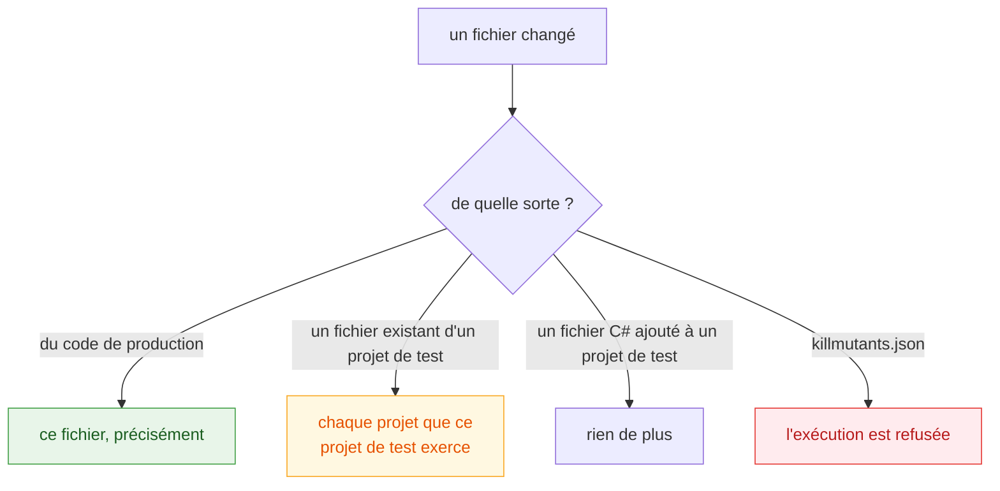

# Juger une pull request

🌍 **Langues :**  
🇬🇧 [English](./pull-requests-en.md) | 🇫🇷 Français (ce fichier)

Un balayage complet d'un vrai dépôt prend des minutes ; un diff prend des secondes. `--since`
n'exécute que ce qu'un changement a touché, et c'est ce qui rend le mutation testing utilisable sur
chaque pull request plutôt qu'une fois par nuit. Cette page dit ce qu'une telle exécution
sélectionne, ce qu'elle affiche, et quand elle refuse de répondre.

## Une seule option

```bash
killmutants --since origin/main
```

Le changement est mesuré depuis la **base de fusion** (merge base) de cette révision et de `HEAD`
jusqu'à l'**arbre de travail**, puisque c'est l'arbre de travail qui est compilé. Sur un checkout
propre — tout job de CI — c'est la même chose que le commit ; sur un portable avec du travail non
commité, ce ne l'est pas, et le rapport dit lequel des deux c'était.

`--since` accepte n'importe quelle révision git : une branche, un tag, un commit. Il a besoin de
git, et il a besoin que la révision de base soit dans le clone — un checkout de CI superficiel ne
suffit souvent pas, et l'exécution le dit plutôt que de comparer en silence avec ce qu'elle peut
atteindre.

## Ce qui est sélectionné



**Le code de production changé est sélectionné précisément**, fichier par fichier : chaque mutant
d'un fichier changé, aucun mutant d'un fichier intact.

**Un changement à un fichier existant d'un projet de test élargit l'exécution** à chaque projet que
ce projet de test exerce. Ce qu'un changement à un test peut retirer, c'est une arête de couverture
— une assertion, un cas, un test entier — et on ne peut pas interroger l'état antérieur sur une
arête qui n'existe plus. L'exécution prend donc tout ce que ce projet de test atteint. Le graphe
des projets est lu aux deux révisions, de sorte que retirer une référence de projet dans le
changement même qui est jugé ne supprime pas la réponse avec la question.

**Un fichier C# que le changement ajoute à un projet de test n'élargit rien** : un nouveau test ne
peut pas avoir retiré une arête qui lui est antérieure. Une fixture, une liste de cas ou un fichier
de réglages ajouté élargit comme n'importe quel autre changement, parce que cet argument n'a jamais
porté sur ceux-là.

**Un changement à `killmutants.json` est refusé.** Ce fichier décide de ce qu'une exécution mesure,
et une exécution partielle ne peut pas juger un changement à sa propre configuration. Pour
celui-là, exécutez sans `--since`.

[DEC0011](../decisions/0011-widen-a-partial-run-selection-when-a-test-file-changes-fr.md) argumente
la règle de sélection en entier.

## Ce qu'elle affiche

```text
KillMutants

Survived (2)

  Shipping.cs
     7:16  orderTotal >= 100m    -> orderTotal > 100m     [Comparison]
    12:38  weightInGrams <= 2000 -> weightInGrams < 2000  [Comparison]

Mutants: 8
Killed: 6
Survived: 2

By mutator

  Comparison       4 mutants, 2 detected
  Conditional      2 mutants, 2 detected
  LogicalOperator  1 mutant, 1 detected
  NegatedDecision  1 mutant, 1 detected

Scope: changes from 24beb47cd6f2 to edited code based on 24beb47cd6f2 (1 file changed)
No mutation score: a partial run's population is the change itself, chosen against an
earlier state, per run, so a percentage over it cannot be compared with any other run.
See DEC0010.
Verdict: 2 undetected mutant(s) in the selected scope.
```

Trois choses diffèrent d'une exécution complète.

**La ligne de portée** dit ce qui a été comparé avec quoi : ici un commit contre l'arbre de travail
édité qui en découle, un fichier changé. Le rapport JSON porte les deux états en toute longueur, de
sorte que la sélection peut être reproduite.

**Il n'y a pas de score, et c'est délibéré.** La population est le changement lui-même, choisi
contre une révision de base qui diffère à chaque exécution, donc un pourcentage calculé dessus ne
répond à rien qui s'étende sur deux exécutions — et un lecteur qui tirerait une tendance de deux
d'entre eux serait le lecteur que le chiffre aurait trompé. Les ratios par famille disparaissent
pour la même raison ; les décomptes restent
([DEC0010](../decisions/0010-a-partial-run-reports-findings-not-a-score-fr.md)).

**Il y a un verdict à la place.** L'exécution **échoue** — code de sortie `1`, une ligne sur
l'erreur standard — si la portée sélectionnée contient un mutant non détecté : survivant *ou* non
couvert, puisque du code qu'un changement ajoute et que rien ne teste du tout relève du second et
non du premier. Sinon, elle passe :

```text
Verdict: no undetected mutant in the selected scope.
```

Un seuil est donc refusé avec `--since` ; passez `--break-at none` pour annuler celui que fixe votre
`killmutants.json`.

## Quand l'exécution s'est élargie, elle le dit

Un seul test édité peut mettre toute une solution dans la portée, et un relecteur devant une
barrière de qualité rouge veut savoir, d'abord, si les survivants sont dans le code que le
changement a touché. Une exécution élargie nomme donc chaque projet qu'elle a pris en entier et les
changements qui l'y ont conduite, et compte combien de mutants non détectés se trouvent dans des
fichiers que le changement n'a pas touchés. Dans le rapport JSON, ce sont `widened` et
`undetectedFromWidening`.

Ces mutants comptent toujours, et font toujours échouer le verdict : un changement à un test peut
empêcher un mutant d'être tué sans toucher au fichier où il se trouve. C'est exactement la
régression que l'élargissement existe pour attraper.

## Quand un projet a perdu ses tests

Une exécution partielle échoue aussi quand le changement ne laisse **plus aucun test atteindre un
projet**. Un tel projet n'a aucun mutant à rapporter — rien ne l'exerce, donc aucune suite ne
pourrait en juger un — ce qui est exactement la façon dont supprimer le dernier test d'un composant
passait autrefois pour un succès propre. Il est nommé à la place :

```text
Coverage lost: no test project reaches Shop any more, so this run had nothing to ask about it.
```

Un projet que vous avez exclu, ou un qui se déclare
[support de test](./mutators-fr.md#laisser-du-code-tranquille), n'est pas dans ce cas : ceux-là
sont délibérés.

## Quand elle ne répond pas

Une exécution partielle **retient son verdict** quand elle n'a pas pu lire l'état antérieur en
entier. Le cas habituel est un sous-module avant `git submodule update --init` : ses objets ne sont
pas dans le clone, donc il ne peut pas être reconstruit — et un projet à l'extérieur peut importer
un fichier de build de l'intérieur, que MSBuild saute alors en silence, de sorte que les références
qu'il aurait ajoutées ont disparu sans rien laisser qui permette de les détecter.

L'exécution a quand même lieu et liste quand même les mutants qu'elle a exécutés. Mais elle imprime
`No verdict` plutôt qu'un verdict favorable, nomme les composants qu'elle n'a pas pu lire, et sort
avec un code non nul. Récupérez-les et relancez, ou exécutez sans `--since`
([DEC0012](../decisions/0012-a-partial-run-abstains-when-the-earlier-state-is-incomplete-fr.md)
consigne pourquoi s'abstenir vaut mieux que refuser l'exécution comme que passer avec un
avertissement accroché).

## Dans un job GitHub Actions

```yaml
- uses: actions/checkout@v4
  with:
    fetch-depth: 0          # --since a besoin de la révision de base dans le clone

- run: dotnet tool restore
- run: dotnet killmutants --since origin/${{ github.base_ref }} --report-json artifacts/mutation.json
```

L'exécution sort avec le code `1` sur un mutant non détecté et le job passe au rouge avec les
constats dans son journal ; le rapport JSON est là pour une étape de résumé.
[Intégration continue](./continuous-integration-fr.md) ajoute un budget de temps, un balayage
nocturne, et le reste.

## Pour aller plus loin

| Si vous voulez… | Lisez |
| --- | --- |
| ajouter une échéance, une barrière de qualité ou un balayage nocturne | [Intégration continue](./continuous-integration-fr.md) |
| lire les champs `widened` et `coverageLost` du rapport JSON | [Lire un rapport](./reading-a-report-fr.md#le-rapport-json) |
| savoir pourquoi une exécution partielle n'imprime pas de score | [Principes de conception](./design-principles-fr.md) |

---

[← Index de la documentation](../README-fr.md)
